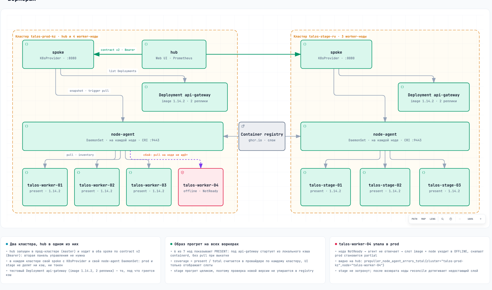
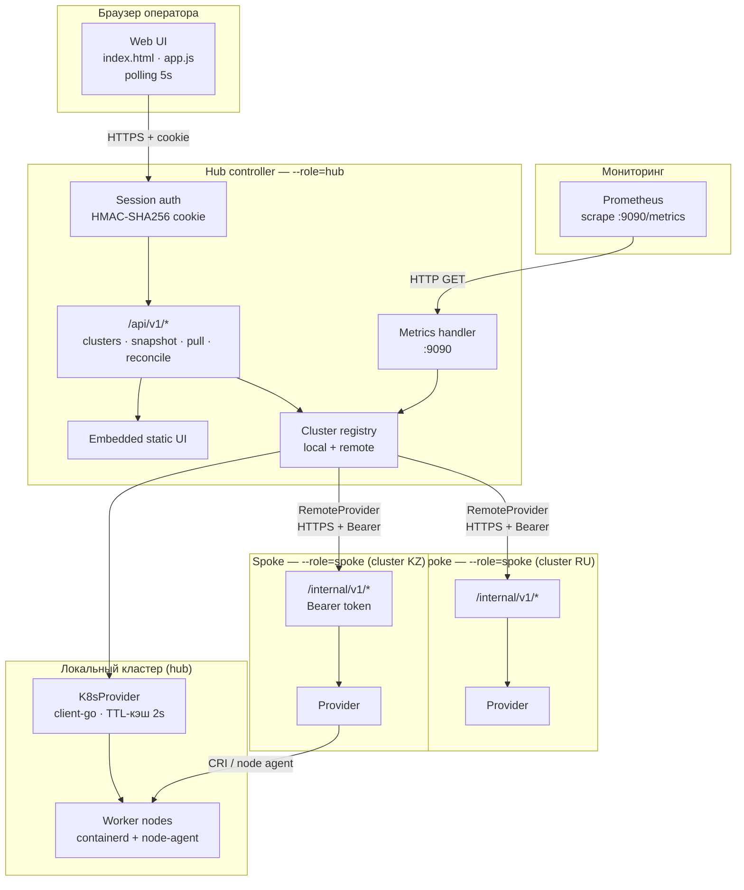
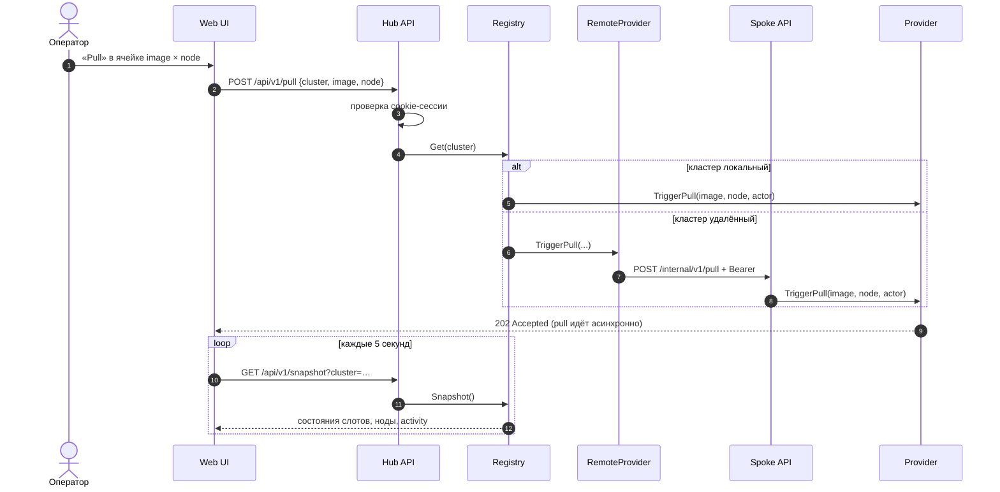
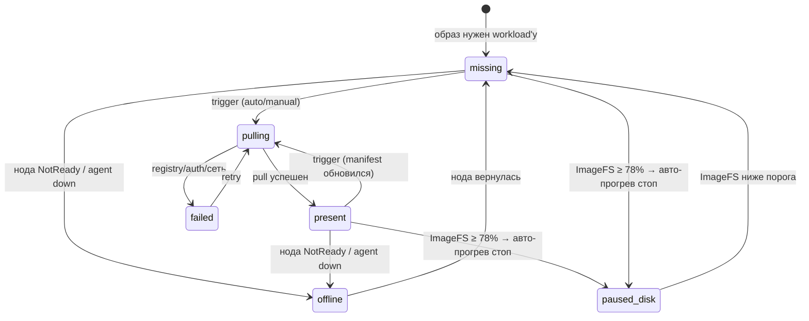

# Image Prepuller

Консоль и API для прогрева image-кэша на worker-нодах Kubernetes: показывает, какие образы
из workload'ов реально лежат на каждой ноде, позволяет дотянуть недостающие, следит за
заполнением ImageFS и отдаёт метрики Prometheus для multi-cluster контура.

> Текущее состояние — **Stage 2/3 (integration)**: live-путь собран — `K8sProvider`
> (client-go) и `node-agent` (CRI containerd), авто-прогрев под флагом `-auto-warm`;
> mock-режим (`-mock`) остаётся для демо и UI-разработки. Контракт заморожен тегом
> `contract-v2`: Provider v2, pull-задачи и отмена, counters на spoke, agent wire v1.
> Что уже готово и что дальше — [Roadmap](#roadmap); внешние зависимости и их границы —
> в [ADR-001](docs/adr/0001-dependencies.md).

## Зачем это нужно

[](docs/diagrams/image-prepuller-overview.html)

Один `hub` живёт в прод-кластере (master) и ведёт несколько кластеров: в каждом стоит
свой `spoke` (K8sProvider поверх Kubernetes API) и свой `node-agent` (DaemonSet на
каждой ноде). `spoke` читает
workload'ы и ноды и строит матрицу `image × node`; `node-agent` дотягивает недостающие
слои через CRI. Кэш containerd у каждой ноды свой, поэтому после прогрева образ лежит
**на всех воркерах кластера**, а не «где-то в кластере»: поды стартуют из локального
кэша, а реестр не становится узким местом при массовой выкатке.

На схеме — два кластера, `talos-prod-kz` (в нём же `hub`) и `talos-stage-ru`, с одним
и тем же нашим софтом и тестовым `Deployment api-gateway` (`image 1.14.2`, 2 реплики). Образ прогрет
на всех воркерах: в stage — на трёх из трёх, в prod — на трёх из четырёх, каждая нода
показывает слот `present`.

И тут же обратная сторона. `talos-worker-04` в `NotReady`, её `node-agent` не
отвечает — слоты `image × node` этой ноды уходят в `OFFLINE`, покрытие prod падает до
3 из 4, hub отдаёт `partial` и ошибку `prepuller_node_agent_errors_total`. stage это не
задевает: прогрев и старт подов там продолжают работать, а когда нода вернётся,
`reconcile` дотянет недостающие слоты.

Схема интерактивная — зум, поиск, подсветка связей, тёмная тема, экспорт в PNG/SVG:
[docs/diagrams/image-prepuller-overview.html](docs/diagrams/image-prepuller-overview.html)
(исходник — [`image-prepuller-overview.json`](docs/diagrams/image-prepuller-overview.json),
собран skill'ом `archify`; PNG в этом разделе — скриншот той же схемы для README).

## Что умеет

- **Workloads view** — Deployment / StatefulSet / DaemonSet, их образы (включая init-контейнеры),
  PullPolicy, покрытие каждого образа по нодам.
- **Матрица image × node** — состояние каждого слота: `present`, `pulling`, `missing`,
  `failed`, `paused_disk`, `offline`; размер, время последней проверки, текст ошибки.
- **Ручной прогрев** — отдельный слот (image + node) или все образы workload'а сразу на все
  онлайн-ноды.
- **Pull Tasks** — журнал асинхронных pull-задач (`queued` / `running` / `succeeded` /
  `failed` / `canceled`): попытка, триггер и актор, время создания и длительность, ошибка;
  активную задачу можно отменить кнопкой (`POST /api/v1/pulls/{id}/cancel`), обновление каждые 5 s.
- **Nodes view** — ImageFS (used/capacity), порог паузы авто-прогрева (78%) и порог kubelet GC
  (85%), активные pull'ы, список закэшированных образов.
- **Node detail** — клик по ноде открывает панель: кэшированные образы с размерами, ImageFS
  used/capacity и процент, `diskPaused`, версия агента и условия ноды (Ready/NotReady);
  панель обновляется каждым поллингом, закрывается кнопкой или Esc.
- **Policy warnings** — `:latest`/отсутствие иммутабельного тега и `imagePullPolicy: Always`
  (ломают offline failover).
- **Activity** — журнал pull-событий с триггером (auto / manual), актором (логин оператора
  или `reconciler`), длительностью и ошибкой.
- **Авто-прогрев** — `internal/reconcile` раз в 30 s сверяет снапшот с желаемым состоянием и
  ставит pull-задачи (`trigger=auto`, actor `reconciler`) с приоритетами, лимитами
  параллелизма и экспоненциальным backoff; включается флагом `-auto-warm`.
- **Node-agent** — `prepuller agent`: HTTP/JSON API v1 рядом с containerd
  (`/agent/v1/snapshot`, `/agent/v1/images/{ref}`, `/agent/v1/pulls`), disk-guard по
  ImageFS и опциональный Bearer-токен.
- **Multi-cluster** — hub агрегирует локальный и удалённые spoke-кластеры через единый
  интерфейс. State-changing вызовы к spoke (pull, workload-pull, отмена, reconcile)
  повторяются с экспоненциальным backoff (3 попытки, таймаут 5 с на попытку);
  недоступный spoke и отклонённый токен дают `502`, а UI не блокируется — снапшот,
  counters и health читаются без ретраев.
- **Prometheus** — отдельный порт `:9090/metrics`, метрики по кластерам, нодам, слотам,
  pull-задачам и свежести синка.

## Архитектура

Сервис — один бинарь с двумя ролями. Hub даёт Web UI и публичный API с cookie-сессией;
spoke — headless-бэкенд рядом с кластером, общается с hub по Bearer-токену.



С флагом `-mock` все провайдеры заменяются на `MockProvider` — ни Kubernetes, ни
containerd не нужны. В live-режиме hub поднимает `K8sProvider` (client-go) и берёт инвентарь
образов ноды у node-agent'а по HTTP/JSON API v1; pull уходит в CRI через агент.

Многокластерный контур (hub + несколько spoke, у каждого свой пул воркеров) показан
Mermaid-схемой выше; интерактивная схема прогрева и отказа ноды — в разделе
[«Зачем это нужно»](#зачем-это-нужно).

### Поток ручного прогрева



### Жизненный цикл образа на ноде



Полная схема компонентов, режимы hub/spoke и модель данных — в
[docs/architecture.md](docs/architecture.md).

## Быстрый старт

Нужен Go 1.26.11+ и доступ к модульному proxy (или прогретый `GOMODCACHE`): с contract-v2
у модуля есть внешние зависимости — grpc, cri-api и client-go (границы и версии —
[ADR-001](docs/adr/0001-dependencies.md)).

```bash
# сборка
go build -o bin/prepuller ./cmd/prepuller

# hub + Web UI на http://localhost:8080 в mock-режиме
export PREPULLER_AUTH_USER=admin
export PREPULLER_AUTH_PASS=admin
export PREPULLER_SESSION_SECRET="$(openssl rand -hex 32)"   # иначе секрет генерится на старте
./bin/prepuller controller -role=hub -mock

# отдельно — headless spoke
export PREPULLER_CLUSTER_TOKEN=spoke-secret
./bin/prepuller controller -role=spoke -mock -http-addr=:8081 -cluster-name=talos-prod-kz

# node-agent на каждой worker-ноде (в кластере — DaemonSet)
export PREPULLER_AGENT_TOKEN=agent-secret
./bin/prepuller agent -mock -node-name=talos-worker-01 -listen-addr=:9443
```

Откройте http://localhost:8080, войдите под `PREPULLER_AUTH_USER` / `PREPULLER_AUTH_PASS`.
В mock-режиме поднимаются три кластера: `talos-prod-eu` (hub), `talos-prod-kz`,
`talos-stage-ru`; у `talos-worker-03` ImageFS заполнен на 80% (пауза авто-прогрева),
`talos-worker-04` — NotReady, часть образов в статусе `failed` / `paused_disk`.

### Проверка

```bash
curl -s localhost:8080/healthz                 # ok
curl -s localhost:8080/readyz                  # ok
curl -s localhost:9090/metrics | head
curl -s -c /tmp/pc -X POST localhost:8080/api/v1/auth/login \
  -H 'Content-Type: application/json' \
  -d '{"username":"admin","password":"admin"}'
curl -s -b /tmp/pc localhost:8080/api/v1/clusters | jq
curl -s -b /tmp/pc 'localhost:8080/api/v1/snapshot?cluster=talos-prod-kz' | jq '.summary'
```

## Деплой

Релизные образ и чарт публикуются в GHCR workflow
[`.github/workflows/build-image.yaml`](.github/workflows/build-image.yaml) (теги `v*`
и `main`, амд64+arm64). Полный чеклист (секреты, стенд в k3d, e2e-сценарий из
[docs/PLAN.md](docs/PLAN.md) §9) — [docs/DEPLOY.md](docs/DEPLOY.md).

```bash
# опубликованные артефакты (public, без логина)
docker pull ghcr.io/vasyakrg/image-prepuller:0.2.0
helm upgrade --install prepuller oci://ghcr.io/vasyakrg/charts/image-prepuller \
  --version 0.2.0 --namespace prepuller --create-namespace \
  --set secret.auth.user=admin --set secret.auth.password='...' \
  --set secret.sessionSecret="$(openssl rand -hex 32)"

# либо сборка из исходников (distroless, nonroot)
docker build -t registry.example.com/ops/image-prepuller:dev .
helm upgrade --install prepuller deploy/helm/image-prepuller \
  --namespace prepuller --create-namespace \
  --set image.repository=registry.example.com/ops/image-prepuller \
  --set image.tag=dev \
  --set secret.auth.user=admin --set secret.auth.password='...' \
  --set secret.sessionSecret="$(openssl rand -hex 32)"
```

`values.yaml` собирает hub в live-режиме (`hub.mock=false`) и включает агентский
DaemonSet; spoke, ingress и NetworkPolicy — отдельными блоками (`spoke.enabled`,
`ingress.enabled`, `networkPolicy.enabled`). Секреты либо генерируются при установке,
либо берутся из `secret.existingSecret` (ключи `auth-user`, `auth-pass`, `session-secret`,
`cluster-token`, `agent-token`). Публикация в GHCR идёт на штатном `GITHUB_TOKEN`
(права `packages: write`), внешних секретов не нужно; старый Gitea-вариант с
`REGISTRY`/`IMAGE` и `REGISTRY_USERNAME`/`REGISTRY_PASSWORD` остался в
[`.gitea/workflows/build-image.yaml`](.gitea/workflows/build-image.yaml) как зеркало.

### Первый кластер (Talos)

Первая раскатка проверена на Talos-кластере (Talos v1.13, Kubernetes v1.36,
Cilium, Traefik, cert-manager). В репозитории лежит только **шаблон** overlay —
[`deploy/values/talos-example.yaml`](deploy/values/talos-example.yaml):
Talos-путь к сокету containerd, toleration для control-plane, ingress с
сертификатом от платформенного `ClusterIssuer`, `autoWarm=false` на первый раскат.

**Репозиторий публичный.** Реальные значения (домен, адреса нод, секрет-стор,
`sha-*` тег сборки) живут в приватном GitOps-репозитории платформы; overlay
конкретного кластера сюда не коммитится — скопируйте шаблон туда и заполните.

```bash
helm upgrade --install prepuller deploy/helm/image-prepuller \
  --namespace prepuller --create-namespace \
  -f <private-overlay>.yaml
```

Пошаговый runbook (DNS, TLS, проверки с ожидаемыми числами, особенности Talos:
`imageFSCapacityBytes=0`, зеркала docker.io, порты 9443/9444 на нодах) — в
[docs/DEPLOY.md §14](docs/DEPLOY.md#14-первый-прод-кластер-talos). Важно:
`image.tag` — `sha-*` сборка того же коммита, что и чарт; релизный образ
`0.2.0` не знает флагов `agent.pull.*` и падает в `CrashLoopBackOff` (см. §14.2).

## Флаги

| Флаг | По умолчанию | Назначение |
| --- | --- | --- |
| `-role` | `hub` | `hub` — Web UI + API + auth; `spoke` — headless backend API |
| `-http-addr` | `:8080` | Адрес HTTP (UI/API) |
| `-metrics-addr` | `:9090` | Адрес Prometheus-метрик (только `GET /metrics`) |
| `-mock` | `false` | In-memory провайдер, Kubernetes не нужен |
| `-cluster-name` | `talos-prod-eu` | Имя локального кластера |
| `-auto-warm` | `false` | Запустить reconciler авто-прогрева для каждого локального кластера |

Подкоманда `agent` — node-agent:

| Флаг | По умолчанию | Назначение |
| --- | --- | --- |
| `-mock` | `false` | In-memory CRI-бэкенд (4 образа, ImageFS 58/100 GiB), containerd не нужен |
| `-listen-addr` | `:9443` | Адрес HTTP/JSON API агента |
| `-metrics-addr` | `:9444` | Отдельный порт Prometheus-метрик агента (без авторизации); пусто — сервер метрик выключен |
| `-node-name` | имя хоста | Имя ноды в снапшотах и pull-задачах |
| `-cri-socket` | `/run/containerd/containerd.sock` | Unix-сокет CRI |
| `-token` | `""` | Bearer-токен для `/agent/v1/*`; пусто — без проверки |
| `-disk-pause-ratio` | `0.78` | Порог ImageFS, после которого pull отклоняется с 409 |
| `-pull-timeout` | `10m` | Потолок одного pull через CRI (страховка для действительно долгих загрузок) |
| `-registry-probe` | `true` | Перед pull агент проверяет TCP-доступность реестра: мёртвый реестр отваливается за секунды, а не за 10 минут |
| `-registry-probe-timeout` | `5s` | Таймаут preflight-пробы реестра |
| `-pull-stall-watch` | `true` | Отменять pull, который перестал растить ImageFS (единственный сигнал прогресса, который даёт CRI) |
| `-pull-stall-timeout` | `60s` | Окно без прогресса, после которого pull считается зависшим (ответ агенту — 504) |

Pull-гигиена node-agent: мёртвый реестр (TCP-соединение висит) больше не занимает слот
image×node на все 10 минут. Агент сначала делает TCP-пробу реестра (5 s) и отдаёт
`502 registry unreachable`; если реестр соединение принимает, но данные не идут, watchdog
следит за ростом ImageFS и через 60 s без прогресса отменяет pull, отдавая `504 pull
stalled`. Hub превращает 504 в `provider.ErrAgentPullStalled` → HTTP 504 для UI, задача
сразу переходит в `failed`. Если containerd тянет образы через **registry mirror** или
**HTTP-прокси** (прокси задан в конфиге containerd, а не в окружении агента), пробу надо
выключить (`-registry-probe=false`, Helm: `agent.pull.registryProbe=false`): containerd
достаёт образ, а прямой dial из агента — нет.

## Переменные окружения

| Переменная | Роль | Обязательна | Описание |
| --- | --- | --- | --- |
| `PREPULLER_USERS` | hub | да* | Список пользователей `name:password:role,...`; роли `viewer` (чтение) и `operator` (чтение + pull/reconcile/cancel) |
| `PREPULLER_AUTH_USER` | hub | да* | Legacy-логин оператора (роль `operator`); работает вместе с `_PASS` |
| `PREPULLER_AUTH_PASS` | hub | да* | Legacy-пароль оператора |
| `PREPULLER_SESSION_SECRET` | hub | нет | Ключ подписи cookie; без него генерируется случайный (сессии живут до рестарта) |
| `PREPULLER_COOKIE_SECURE` | hub | нет | `true` — всегда ставить `Secure` на cookie (TLS терминируется перед hub) |
| `PREPULLER_LOGIN_ATTEMPTS_PER_MINUTE` | hub | нет | Лимит попыток логина на IP и на username, по умолчанию `5` |
| `PREPULLER_LOGIN_BLOCK` | hub | нет | Блокировка после исчерпания лимита, по умолчанию `5m` |
| `PREPULLER_CLUSTER_TOKEN` | spoke | нет | Bearer-токен для `/internal/v1/*`; пустое значение = API без авторизации |
| `PREPULLER_REMOTE_CLUSTERS` | hub | нет | Дополнительные spoke: `name=url=token,name2=url2=token2` |
| `PREPULLER_AGENT_TOKEN` | agent + hub + spoke | нет | Bearer-токен агентского API: его проверяет агент (`-token`) и им же hub/spoke ходят в `GET /agent/v1/snapshot` и `POST /agent/v1/pulls`; пусто — без авторизации |
| `PREPULLER_AGENT_METRICS_ADDR` | agent | нет | Адрес Prometheus-метрик агента, по умолчанию `:9444`; пусто — выключить сервер метрик |

\* нужен либо `PREPULLER_USERS`, либо legacy-пара `PREPULLER_AUTH_USER`/`_PASS`.

## HTTP API

Все защищённые ручки hub требуют cookie `prepuller_session` (HttpOnly, SameSite=Lax,
`Secure` при TLS или `X-Forwarded-Proto: https`). Health-ручки открыты.

### Пользователи и роли

Пользователи задаются списком `PREPULLER_USERS="name:password:role,..."`, роли —
`viewer` (только чтение) и `operator` (чтение + pull/workload-pull/reconcile/cancel).
Старые `PREPULLER_AUTH_USER`/`PREPULLER_AUTH_PASS` продолжают работать и дают роль
`operator`. Пароль может содержать `:` — роль берётся после последнего двоеточия.
Cookie-сессии подписаны HMAC-SHA256 и несут роль; cookie старого формата (без роли)
принимаются один релиз и трактуются как `operator`. Логин ограничен 5 попытками/мин
на IP и на username, блок 5 мин, ответ `429` + `Retry-After`; успешный логин сбрасывает
счётчики. Неудачные и запрещённые действия пишутся в аудит (JSON-строки в stderr,
последние 500 событий доступны оператору через `GET /api/v1/audit`). Пароли и cookie
в аудит не попадают. UI получает роль из login/`/auth/me` и у `viewer`
отключает pull/cancel/sync (сервер всё равно отвечает `403`).

| Метод и путь | Доступ | Описание |
| --- | --- | --- |
| `GET /healthz` | открыт | Liveness, `ok` |
| `GET /readyz` | открыт | Readiness, `ok` |
| `POST /api/v1/auth/login` | открыт | `{username,password}` → ставит cookie; `200 {username,role}`; `401` при неверной паре; `429` + `Retry-After` при превышении лимита |
| `POST /api/v1/auth/logout` | открыт | Сбрасывает cookie |
| `GET /api/v1/auth/me` | cookie | `{username,role}` или 401 |
| `GET /api/v1/clusters` | cookie | `{defaultCluster, apiVersion, clusters[]}` |
| `GET /api/v1/snapshot?cluster=ID` | cookie | Полный снимок кластера (`model.Snapshot`, contract v2) |
| `POST /api/v1/pull` | cookie, `operator` | `{cluster,image,node}` → 202 `{status,image,node,task}` |
| `POST /api/v1/workloads/pull` | cookie, `operator` | `{cluster,namespace,kind,name}` → 202 `{triggered}` |
| `POST /api/v1/reconcile` | cookie, `operator` | `{cluster}` → 200, принудительный синк |
| `GET /api/v1/pull-tasks?cluster=ID` | cookie | `{cluster, tasks[]}` — асинхронные pull-задачи (v2) |
| `POST /api/v1/pulls/{id}/cancel?cluster=ID` | cookie, `operator` | Отмена queued/running задачи → 202; 404 — нет задачи (v2) |
| `GET /api/v1/nodes/{node}/images?cluster=ID` | cookie | Кэш образов и ImageFS одной ноды (v2) |
| `GET /api/v1/health?cluster=ID` | cookie | `model.Health` провайдера кластера (v2) |
| `GET /api/v1/audit` | cookie, `operator` | Последние 500 событий аудита `{events:[{time,actor,role,action,target,result,remoteAddr}]}` |

Spoke (только если задан `PREPULLER_CLUSTER_TOKEN` — Bearer):

| Метод и путь | Описание |
| --- | --- |
| `GET /internal/v1/snapshot` | Снимок кластера (contract v2) |
| `POST /internal/v1/pull` | `{apiVersion,image,node,actor,trigger,policy}` → 202 `model.PullTask` |
| `POST /internal/v1/workloads/pull` | `{apiVersion,namespace,kind,name,actor}` → 202 `{triggered}` |
| `POST /internal/v1/reconcile` | `{apiVersion,actor}` → 200 |
| `GET /internal/v1/counters` | `provider.SpokeCounters`: `pullTotal`, `pullSucceeded`, `pullFailed`, `pullCanceled`, `pullInFlight`, `imagesCached`, `lastSyncAt`, `samples[]` — источник `prepuller_pull_total` для hub |
| `GET /internal/v1/health` | Дешёвый liveness/версия spoke: `model.Health` + `apiVersion`, `uptimeSeconds`; не вызывает `Snapshot` |
| `POST /internal/v1/pulls/{id}/cancel` | Отмена задачи → 202; 404 — задача не найдена; 409 — задача уже завершена |

Тело запроса ограничено 1 МиБ (413), неизвестный `apiVersion` — 400; все ошибки —
`{"error":"..."}`.

Поле `apiVersion` в запросах обязательно только для новых клиентов: пустое значение и
`v1` принимаются в течение одного релиза (см. [docs/PLAN.md](docs/PLAN.md) §10).

Node-agent (HTTP/JSON, API v1; `/healthz` открыт, остальное — Bearer из `-token`):

| Метод и путь | Описание |
| --- | --- |
| `GET /healthz` | `{apiVersion,status,node,agentVersion}`, без авторизации |
| `GET /agent/v1/snapshot` | Инвентарь ноды: образы, ImageFS, runtime, условия, `diskPaused` |
| `GET /agent/v1/images/{ref}` | Один образ по имени/ID; 404 — не найден |
| `POST /agent/v1/pulls` | `{image}` → pull через CRI; 409 — `diskPaused`, 502 — ошибка CRI |

## Метрики

Hub и spoke экспортируют метрики на отдельном порту (`-metrics-addr`, по умолчанию
`:9090`) в текстовом формате Prometheus:

| Метрика | Тип | Метки |
| --- | --- | --- |
| `prepuller_cluster_up` | gauge | `cluster`, `role` |
| `prepuller_image_present` | gauge | `cluster`, `namespace`, `workload_kind`, `workload_name`, `image`, `node` |
| `prepuller_workload_policy_violation` | gauge | те же + `reason` |
| `prepuller_node_agent_up` | gauge | `cluster`, `node` |
| `prepuller_node_disk_paused` | gauge | `cluster`, `node` |
| `prepuller_node_imagefs_used_bytes` | gauge | `cluster`, `node` |
| `prepuller_node_imagefs_capacity_bytes` | gauge | `cluster`, `node` |
| `prepuller_pull_total` | counter | `cluster`, `image`, `node`, `result` |
| `prepuller_pull_tasks` | gauge | `cluster`, `state` (`queued`/`running`/`succeeded`/`failed`/`canceled`) |
| `prepuller_pull_task_duration_seconds` | gauge | `cluster`, `state` (только терминальные; среднее по `durationMs`) |
| `prepuller_node_imagefs_free_bytes` | gauge | `cluster`, `node` |
| `prepuller_node_ready` | gauge | `cluster`, `node` |
| `prepuller_images_cached_total` | gauge | `cluster`, `node` |
| `prepuller_agent_info` | gauge | `cluster`, `node`, `version` |
| `prepuller_node_last_seen_timestamp_seconds` | gauge | `cluster`, `node` (нет серии при нулевом `LastSeen`) |
| `prepuller_node_agent_errors_total` | counter | `cluster`, `node`, `reason` (`unauthorized`/`protocol`/`timeout`/`unavailable`) |
| `prepuller_cluster_last_sync_timestamp_seconds` | gauge | `cluster` |
| `prepuller_cluster_sync_partial` | gauge | `cluster` |
| `prepuller_snapshot_age_seconds` | gauge | `cluster` (сколько секунд прошло с последней успешной синхронизации) |
| `prepuller_snapshot_scrape_timeout_total` | counter | `cluster` (скрейп не дождался снапшота) |
| `prepuller_build_info` | gauge | `version`, `commit`, `go_version` |

С contract-v2 `prepuller_pull_total` заполняется и для удалённых кластеров:
`RemoteProvider.PullCounters()` ходит в `GET /internal/v1/counters` своего spoke.

Скрейп делает ровно один `Provider.Snapshot()` на кластер — все серии строятся из одного
снимка. `prepuller_cluster_up=0` и `prepuller_cluster_sync_partial=1` для offline/partial
кластеров; `..._last_sync_timestamp_seconds` отсутствует, если `LastSyncAt` неизвестен, и
никогда не подменяется текущим временем.

Скрейп ограничен по времени (`3 s` на все кластеры), чтобы авария связи с агентом не
обнуляла весь таргет: не успевший кластер отдаёт последний успешный снапшот, а
`prepuller_snapshot_age_seconds` растёт — это и есть сигнал «hub ослеп».
`prepuller_node_agent_errors_total` заполняет только `K8sProvider` (опциональная
capability `provider.AgentErrorCounter`), поэтому у mock/remote кластеров серии нет.

Node-agent отдаёт свои метрики **на отдельном порту** (`-metrics-addr`, по умолчанию
`:9444`, без авторизации, только счётчики и gauge'и; на скрейпе агент не ходит в CRI):

| Метрика агента | Тип | Метки |
| --- | --- | --- |
| `prepuller_agent_up` | gauge | `node` (dead-man: серия исчезает вместе с агентом) |
| `prepuller_agent_build_info` | gauge | `node`, `version`, `go_version` |
| `prepuller_agent_start_time_seconds` | gauge | `node` |
| `prepuller_agent_last_contact_timestamp_seconds` | gauge | `node`, `endpoint` (`healthz`/`snapshot`/`images`/`pulls`; инициализируется временем старта) |
| `prepuller_agent_requests_total` | counter | `node`, `endpoint`, `code` |
| `prepuller_agent_cri_up` | gauge | `node` (последний снапшот смог поговорить с CRI) |
| `prepuller_agent_pull_in_flight` | gauge | `node` |
| `prepuller_agent_pull_total` | counter | `node`, `result` (`success`/`cri_error`/`stalled`/`registry_unreachable`/`disk_paused`) |
| `prepuller_agent_imagefs_used_bytes`, `..._capacity_bytes`, `prepuller_agent_images_cached_total` | gauge | `node` (значения последнего успешного снапшота) |

Готовые правила алертов, пороги и матрица «кто виноват: агент, токен или связь» —
[docs/alerts.md](docs/alerts.md) и шаблон `PrometheusRule` в чарте (`prometheusRule.enabled`).

## Структура репозитория

```
cmd/prepuller/          точка входа: controller (hub/spoke) и agent, запуск/graceful shutdown
internal/agent/         node-agent: CRI-клиент, инвентарь образов, disk-guard, HTTP/JSON API v1
internal/auth/          cookie-сессии и middleware (RequireAuth, RequireToken)
internal/model/         доменные типы и JSON-контракт API v2 (Snapshot, PullTask, ImageRef, …)
internal/provider/      Provider v2, MockProvider, RemoteProvider, K8sProvider (client-go), Registry
internal/reconcile/     политика авто-прогрева: очередь, приоритеты, лимиты, backoff
internal/web/           hub-роутер (server.go) + spoke-роутер (server_spoke.go), embed статики
internal/web/static/    index.html, app.js, styles.css — без сборки и npm
internal/metrics/       ручная генерация Prometheus text exposition
internal/testutil/      фейковый spoke/hub, golden-снапшот v2, контрактные тесты hub↔spoke
docs/                   architecture.md, PLAN.md, ADR-001, DEPLOY.md
docs/diagrams/          интерактивная схема продукта (archify JSON + HTML + PNG для README)
deploy/helm/            Helm-чарт: hub, spoke, agent DaemonSet, RBAC, NetworkPolicy, ingress
Dockerfile              образ: distroless, nonroot, linux/amd64+arm64
.github/workflows/      CI (гейты), PR-Agent и публикация образа + чарта в GHCR
.gitea/workflows/       те же CI/сборочные workflow для Gitea (зеркало)
hack/e2e-k3d.sh         локальный e2e-смоук на k3d (приёмка Stage 2/3)
CHANGELOG.md            история версий
```

## Разработка

```bash
go test ./...            # auth, agent, provider, reconcile, metrics, web, контрактные тесты
go vet ./...
gofmt -l .
go build -o bin/prepuller ./cmd/prepuller
```

Если `GOCACHE`/`GOMODCACHE` недоступны (песочница, read-only HOME), задайте их внутри
рабочего каталога:

```bash
export GOCACHE=$PWD/.gocache GOPATH=$PWD/.gopath GOMODCACHE=$PWD/.gopath/pkg/mod
go mod download && go test ./...
```

`.gocache/`, `.gopath/`, `.gomodcache/` и `bin/` — в `.gitignore`. Правила, инварианты
и зоны записи для агентов — в [AGENTS.md](AGENTS.md) и [docs/PLAN.md](docs/PLAN.md).

Гейты (gofmt/vet/test/helm) и сборка релиза — [`.github/workflows/ci.yaml`](.github/workflows/ci.yaml)
и [`.github/workflows/build-image.yaml`](.github/workflows/build-image.yaml). E2E в CI
намеренно не гоняется: приёмка Stage 2/3 запускается локально перед пушем в `main`
(нужны docker и k3d):

```bash
bash hack/e2e-k3d.sh          # собрать образ, поднять одноразовый кластер, прогнать сценарий
KEEP=1 bash hack/e2e-k3d.sh   # оставить кластер для разбора
```

Ревью pull request'ов моделью — [`.github/workflows/pr-agent.yml`](.github/workflows/pr-agent.yml):
на открытие PR и по команде в комментарии (`/review`, `/describe`, `/ask ...`). Секреты
(`OPENAI_API_BASE`, `OPENAI_KEY`), проверка `doctor` и список граблей — в
[docs/pr-agent.md](docs/pr-agent.md).

## Roadmap

Подробный план работ с разбивкой на параллельные потоки, зоны записи и порядок мержа —
в [docs/PLAN.md](docs/PLAN.md).

| Этап | Содержание |
| --- | --- |
| Stage 1 (готово) | Mock-провайдер, hub/spoke, Web UI, auth, multi-cluster, метрики |
| contract-v2 (готово) | Provider v2 (PullTask/CancelPull/Health), counters+cancel на spoke, заглушки API, testutil, CI-каркас |
| Stage 2 (готово) | node-agent: CRI containerd, инвентарь образов, disk-guard, HTTP/JSON API v1, pull через агент |
| Stage 3 (готово) | `K8sProvider` (client-go): workload'ы, слоты image×node, TTL-кэш снапшота, reconciler и `-auto-warm`; транспорт к node-agent (HTTP/JSON v1, Bearer, таймауты), живой pull и present-слоты из CRI-инвентаря — включён в `main.go` через `provider.NewK8sProviderFromEnv` |
| v0.2.0 (готово) | Деплой: Dockerfile, Helm-чарт, CI-сборка образа и чарта; multi-user auth/RBAC и rate-limit; надёжный транспорт hub↔spoke |
| Далее | алерты по покрытию и ImageFS, e2e в k3d в CI, CSRF-токены, durable audit sink, argon2id |

## Известные ограничения

- CSRF-токенов нет: state-changing ручки защищены `SameSite=Lax` и JSON-body.
- Rate-limit логина in-memory и per-process: у нескольких реплик hub счётчики свои;
  `ClientIP` берётся из `RemoteAddr`, поэтому за ingress все клиенты могут делить один IP.
- Аудит не долговечен: JSON-строки в stderr без ротации + ring на 500 событий в памяти.
- Пароли хранятся в памяти открытым текстом из env; argon2id/bcrypt — отдельный ADR.
- Смена роли не инвалидирует активные сессии: роль берётся из подписанной cookie (TTL 24 ч).
- В mock `SyncNow` только обновляет `lastSeen`/`lastChecked`; в live-режиме сверку выполняет
  `K8sProvider` (list workload'ов и нод + инвентарь от агента, TTL-кэш 2 s), а авто-прогрев —
  reconciler под флагом `-auto-warm`.
- `Missing` в mock почти не возникает: все слоты инициализируются `present`/офлайн/паузой;
  `missing` появляется только после отмены pull-задачи (`POST /api/v1/pulls/{id}/cancel`).
- `tasks` в mock ограничены 200 последними, `activity` — 100; пагинации пока нет.
- Один экземпляр hub: состояние (сессии, реестр) in-memory, реплики не разделяют данные.
- Транспорт hub→spoke повторяет только идемпотентные state-changing вызовы (pull,
  workload-pull, cancel, reconcile) — максимум 3 попытки с backoff; `Snapshot`,
  `counters` и `health` читаются одним запросом, чтобы мёртвый spoke не тормозил
  страницу и скрейп метрик. Таймаут одной попытки — 5 с.
- Hub/spoke без `-mock` собирают live-провайдер из in-cluster конфига, иначе из
  `$KUBECONFIG` / `~/.kube/config` (вне кластера) и падают на старте, если конфига нет.
  Ноды без доступного агента дают `offline`-слоты, `syncStatus=degraded` и `partial=true`;
  pull-задача при этом падает с `502`, а при диске выше порога — с `409`.
