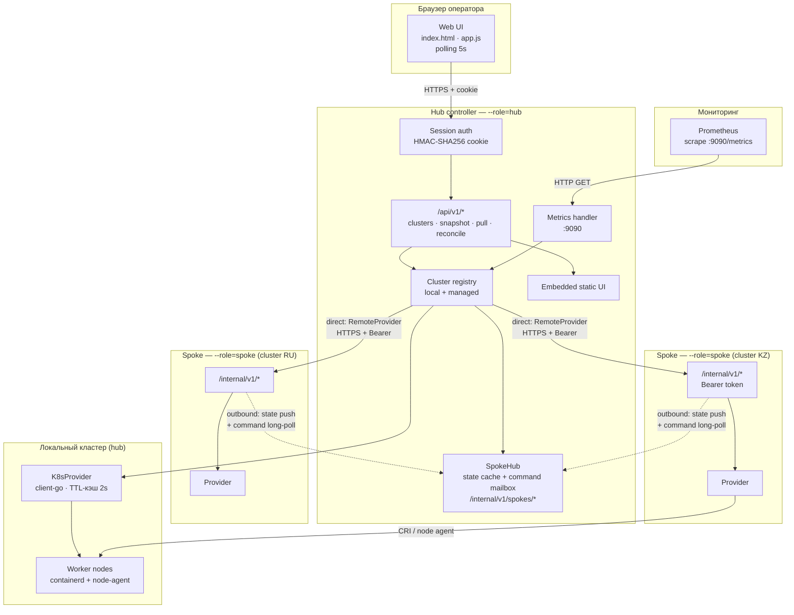
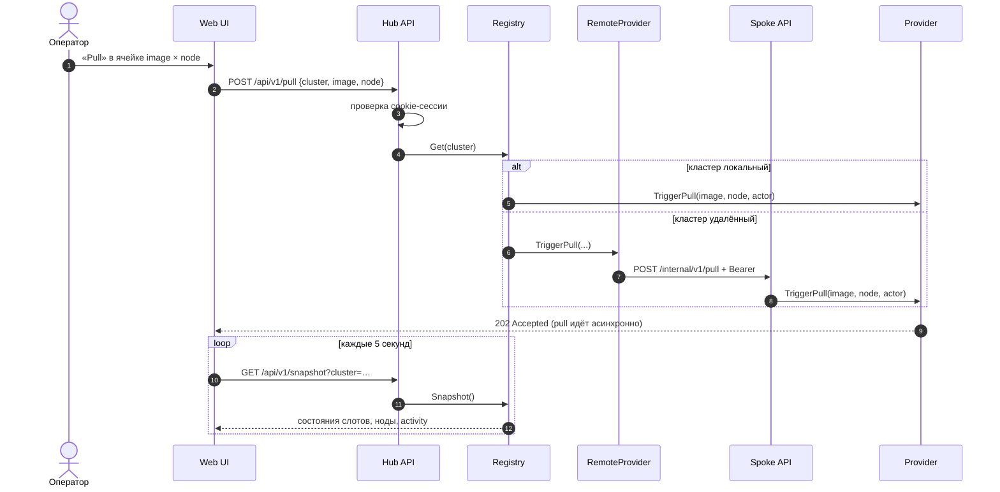
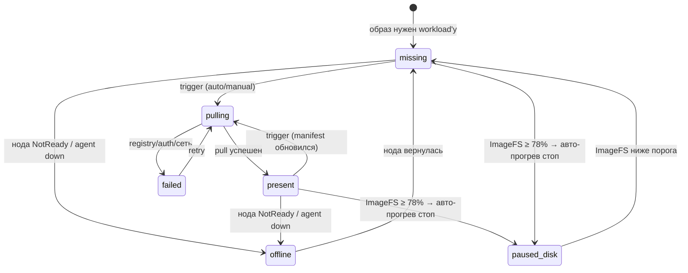

# Image Prepuller

Консоль и API для прогрева image-кэша на worker-нодах Kubernetes: показывает, какие образы
из workload'ов реально лежат на каждой ноде, позволяет дотянуть недостающие, следит за
заполнением ImageFS и отдаёт метрики Prometheus для multi-cluster контура.

> Текущее состояние — **Stage 2/3 (integration)**: live-путь собран — `K8sProvider`
> (client-go) и `node-agent` (CRI containerd), авто-прогрев под флагом `-auto-warm`;
> mock-режим (`-mock`) остаётся для демо и UI-разработки. Контракт заморожен тегом
> `contract-v2`: Provider v2, pull-задачи и отмена, counters на spoke, agent wire v1.
> Что уже готово и что дальше — [Roadmap](#roadmap); внешние зависимости и их границы —
> в [ADR-001](docs/adr/0001-dependencies.md).

## Зачем это нужно

[](docs/diagrams/image-prepuller-overview.html)

Один `hub` живёт в прод-кластере (master) и ведёт несколько кластеров: в каждом стоит
свой `spoke` (K8sProvider поверх Kubernetes API) и свой `node-agent` (DaemonSet на
каждой ноде). `spoke` читает
workload'ы и ноды и строит матрицу `image × node`; `node-agent` дотягивает недостающие
слои через CRI. Кэш containerd у каждой ноды свой, поэтому после прогрева образ лежит
**на всех воркерах кластера**, а не «где-то в кластере»: поды стартуют из локального
кэша, а реестр не становится узким местом при массовой выкатке.

На схеме — два кластера, `talos-prod-kz` (в нём же `hub`) и `talos-stage-ru`, с одним
и тем же нашим софтом и тестовым `Deployment api-gateway` (`image 1.14.2`, 2 реплики). Образ прогрет
на всех воркерах: в stage — на трёх из трёх, в prod — на трёх из четырёх, каждая нода
показывает слот `present`.

И тут же обратная сторона. `talos-worker-04` в `NotReady`, её `node-agent` не
отвечает — слоты `image × node` этой ноды уходят в `OFFLINE`, покрытие prod падает до
3 из 4, hub отдаёт `partial` и ошибку `prepuller_node_agent_errors_total`. stage это не
задевает: прогрев и старт подов там продолжают работать, а когда нода вернётся,
`reconcile` дотянет недостающие слоты.

Схема интерактивная — зум, поиск, подсветка связей, тёмная тема, экспорт в PNG/SVG:
[docs/diagrams/image-prepuller-overview.html](docs/diagrams/image-prepuller-overview.html)
(исходник — [`image-prepuller-overview.json`](docs/diagrams/image-prepuller-overview.json),
собран skill'ом `archify`; PNG в этом разделе — скриншот той же схемы для README).

## Что умеет

- **Область действия** — контроллер работает только с тем, что помечено: флаг
  `-workload-selector` ограничивает список workload'ов (в чарте по умолчанию
  `prepull=true`), `-node-selector` — список нод (значение чарта по умолчанию —
  `!node-role.kubernetes.io/control-plane`: агенты стоят на воркерах, иначе
  control-plane ноды всю жизнь висели бы offline-слотами). Всё остальное не
  показывается, не считается в покрытии и не прогревается. Нужен control-plane —
  верните `agent.tolerations` и очистите селектор.
- **Workloads view** — Deployment / StatefulSet / DaemonSet, попавшие в `-workload-selector`:
  их образы (включая init-контейнеры), PullPolicy, покрытие каждого образа по нодам.
  У образа с нарушением политики проблемный токен описания подсвечивается жёлтым
  (тег `:latest` в самой ссылке, `policy: Always` рядом с ней) — видно, что именно
  ломает offline failover, без раскрытия строки и чтения tooltip.
- **Обзорные метрики** — пять карточек над таблицей: помеченные workload'ы, покрытие
  кэша (`presentSlots / totalSlots` в виде «образ × нода»), состояние агентов
  (`3 / 4` — сколько нод отвечают на API node-agent'а), занятое место ImageFS
  (сумма по нодам + худшая нода по заполнению) и policy warnings (клик — фильтр).
- **Матрица image × node** — состояние каждого слота: `present`, `pulling`, `missing`,
  `failed`, `paused_disk`, `offline`; размер, время последней проверки, текст ошибки.
- **Ручной прогрев** — отдельный слот (image + node) или все образы workload'а сразу на все
  онлайн-ноды.
- **Pull Tasks** — журнал асинхронных pull-задач (`queued` / `running` / `succeeded` /
  `failed` / `canceled`): попытка, триггер и актор, время создания и длительность, ошибка;
  активную задачу можно отменить кнопкой (`POST /api/v1/pulls/{id}/cancel`): в live-режиме
  отмена закрывает запрос к агенту и прерывает CRI-загрузку на ноде. Список листается
  страницами (25/50/100 на страницу, фильтр по состоянию) через
  `GET /api/v1/pull-tasks?limit=&offset=&state=`: hub держит собственную ограниченную
  историю задач (`-pull-history-file`, по умолчанию 2000 записей), поэтому она не
  зависит от того, сколько задач провайдер держит в памяти, и переживает рестарт
  контейнера (в чарте — `hub.pullHistory`). Бейдж в меню обновляется каждые 2 s и
  показывает активные задачи плюс завершённые за последние 30 s — короткий pull
  больше не выглядит как «задач нет».
- **Nodes view** — ImageFS (used/capacity), порог паузы авто-прогрева (78%) и порог kubelet GC
  (85%), активные pull'ы, список закэшированных образов. Если CRI сообщает только used
  (containerd на Talos), ёмкость берётся из `ephemeral-storage` ноды и помечается
  `est.`/`~`; если и её нет, вместо ложных «0 B (0.0%)» показывается «ёмкость неизвестна».
- **Node detail** — клик по ноде открывает панель: кэшированные образы с размерами и
  поиском по ним (имя/тег/digest), ImageFS used/capacity и процент, `diskPaused`,
  версия агента и условия ноды. Цвет условия зависит от его типа: `Ready: True` —
  зелёный, `DiskPressure: True` — красный (для pressure-условий здоровое значение
  `False`); панель обновляется каждым поллингом, закрывается кнопкой или Esc.
- **Policy warnings** — `:latest`/отсутствие иммутабельного тега и `imagePullPolicy: Always`
  (ломают offline failover).
- **Activity** — журнал pull-событий с триггером (auto / manual), актором (логин оператора
  или `reconciler`), длительностью и ошибкой.
- **Авто-прогрев** — `internal/reconcile` раз в 30 s сверяет снапшот с желаемым состоянием и
  ставит pull-задачи (`trigger=auto`, actor `reconciler`) с приоритетами, лимитами
  параллелизма и экспоненциальным backoff; включается флагом `-auto-warm`.
- **Node-agent** — `prepuller agent`: HTTP/JSON API v1 рядом с containerd
  (`/agent/v1/snapshot`, `/agent/v1/images/{ref}`, `/agent/v1/pulls`), disk-guard по
  ImageFS и опциональный Bearer-токен.
- **Приватные реестры** — pull через CRI получает те же креды, что и kubelet:
  контроллер читает `imagePullSecrets` workload'а (`kubernetes.io/dockerconfigjson` и
  legacy `.dockercfg`, RBAC `get` на secrets — `rbac.readSecrets`) и передаёт их
  агенту в запросе pull. Без кредов задача падает с `registry authentication failed` и
  подсказкой, чего именно не хватило, вместо голого `403` от реестра.
- **Multi-cluster** — hub агрегирует локальный и управляемые spoke-кластеры через
  единый интерфейс, в двух топологиях. **Прямая (direct)**: hub сам ходит в spoke по
  HTTP (регистрация `hub.remoteClusters` / `PREPULLER_REMOTE_CLUSTERS`); state-changing
  вызовы повторяются с экспоненциальным backoff (3 попытки, таймаут 5 с на попытку),
  недоступный spoke и отклонённый токен дают `502`, а UI не блокируется — снапшот,
  counters и health читаются без ретраев. **Исходящая (outbound/pull)** — spoke сам
  подключается к ingress'у hub'а и держит канал: пушит состояние кластера и long-poll'ит
  команды, поэтому входящий маршрут в управляемый кластер не нужен. Это режим по
  умолчанию для кластеров за NAT и без ingress: наружу нужен только исходящий HTTPS
  на 443.
- **Stats (вкладка UI)** — если включена PostgreSQL-статистика (`hub.stats`), в меню
  появляется вкладка `Stats`: история без SQL — окно 1h…90d, фильтр по кластеру, KPI
  (ноды, образы в кэше и их размер, GC, перепулы, задачи) и таблицы «Ноды (последний
  срез)», «Присутствие образов» (поиск, «лежат сейчас / удалены»), «События сборщика»,
  «Перепулы» и «Лог pull-задач» с пагинацией. Если DSN не задан, вкладка честно пишет
  «Сбор статистики выключен администратором»; если база недоступна — баннер с
  «Повторить». Ручки — `GET /api/v1/stats/*` (read-only, cookie), см. «HTTP API».
- **Prometheus** — отдельный порт `:9090/metrics`, метрики по кластерам, нодам, слотам,
  pull-задачам и свежести синка.

## Архитектура

Сервис — один бинарь с двумя ролями. Hub даёт Web UI и публичный API с cookie-сессией;
spoke — headless-бэкенд рядом с кластером, общается с hub по Bearer-токену.



С флагом `-mock` все провайдеры заменяются на `MockProvider` — ни Kubernetes, ни
containerd не нужны. В live-режиме hub поднимает `K8sProvider` (client-go) и берёт инвентарь
образов ноды у node-agent'а по HTTP/JSON API v1; pull уходит в CRI через агент.

Управляемый кластер подключается к hub'у двумя способами, и оба сосуществуют в одном
реестре:

- **direct** — hub сам ходит в spoke по HTTP (`hub.remoteClusters` /
  `PREPULLER_REMOTE_CLUSTERS`). Нужен маршрут hub → spoke: общая сеть, либо
  ingress/LoadBalancer в управляемом кластере.
- **outbound («pull»)** — spoke запускается с `-hub-url`, сам подключается к ingress'у
  hub'а, пушит состояние кластера (snapshot + counters) и long-poll'ит команды. Входящий
  маршрут в управляемый кластер не нужен, только исходящий HTTPS из него на hub (443).
  **Это рекомендуемый режим для управляемых кластеров за NAT/без ingress** и
  единственный вариант, когда hub не может достучаться до кластера. Регистрация — `hub.managedClusters`
  / `PREPULLER_MANAGED_CLUSTERS`.

Чтения на hub'е (snapshot, counters, health, UI, `/metrics`) в outbound-режиме
обслуживаются из последнего присланного состояния, без запроса на каждый вызов;
state-changing вызовы (pull, workload-pull, cancel, reconcile) едут командами по тому же
каналу. Подробности — [docs/architecture.md](docs/architecture.md).

Многокластерный контур (hub + несколько spoke, у каждого свой пул воркеров) показан
Mermaid-схемой выше; интерактивная схема прогрева и отказа ноды — в разделе
[«Зачем это нужно»](#зачем-это-нужно).

### Поток ручного прогрева



### Жизненный цикл образа на ноде



Полная схема компонентов, режимы hub/spoke и модель данных — в
[docs/architecture.md](docs/architecture.md).

## Быстрый старт

Нужен Go 1.26.11+ и доступ к модульному proxy (или прогретый `GOMODCACHE`): с contract-v2
у модуля есть внешние зависимости — grpc, cri-api и client-go (границы и версии —
[ADR-001](docs/adr/0001-dependencies.md)).

```bash
# сборка
go build -o bin/prepuller ./cmd/prepuller

# hub + Web UI на http://localhost:8080 в mock-режиме
export PREPULLER_AUTH_USER=admin
export PREPULLER_AUTH_PASS=admin
export PREPULLER_SESSION_SECRET="$(openssl rand -hex 32)"   # иначе секрет генерится на старте
./bin/prepuller controller -role=hub -mock

# отдельно — headless spoke
export PREPULLER_CLUSTER_TOKEN=spoke-secret
./bin/prepuller controller -role=spoke -mock -http-addr=:8081 -cluster-name=talos-prod-kz

# node-agent на каждой worker-ноде (в кластере — DaemonSet)
export PREPULLER_AGENT_TOKEN=agent-secret
./bin/prepuller agent -mock -node-name=talos-worker-01 -listen-addr=:9443
```

Откройте http://localhost:8080, войдите под `PREPULLER_AUTH_USER` / `PREPULLER_AUTH_PASS`.
В mock-режиме поднимаются три кластера: `talos-prod-eu` (hub), `talos-prod-kz`,
`talos-stage-ru`; у `talos-worker-03` ImageFS заполнен на 80% (пауза авто-прогрева),
`talos-worker-04` — NotReady, часть образов в статусе `failed` / `paused_disk`.

### Проверка

```bash
curl -s localhost:8080/healthz                 # ok
curl -s localhost:8080/readyz                  # ok
curl -s localhost:9090/metrics | head
curl -s -c /tmp/pc -X POST localhost:8080/api/v1/auth/login \
  -H 'Content-Type: application/json' \
  -d '{"username":"admin","password":"admin"}'
curl -s -b /tmp/pc localhost:8080/api/v1/clusters | jq
curl -s -b /tmp/pc 'localhost:8080/api/v1/snapshot?cluster=talos-prod-kz' | jq '.summary'
```

## Деплой

Релизные образ и чарт публикуются в GHCR workflow
[`.github/workflows/ci.yaml`](.github/workflows/ci.yaml): сначала гейты `test` + `helm`,
и только после них — сборка `image`/`chart` (теги `v*` и `main`, амд64+arm64).
Полный чеклист (секреты, стенд в k3d, e2e-сценарий из
[docs/PLAN.md](docs/PLAN.md) §9) — [docs/DEPLOY.md](docs/DEPLOY.md).

```bash
# опубликованные артефакты (public, без логина)
docker pull ghcr.io/vasyakrg/image-prepuller:1.0.0
helm upgrade --install prepuller oci://ghcr.io/vasyakrg/charts/image-prepuller \
  --version 1.0.0 --namespace prepuller --create-namespace \
  --set secret.auth.user=admin --set secret.auth.password='...' \
  --set secret.sessionSecret="$(openssl rand -hex 32)"

# либо сборка из исходников (distroless, nonroot)
docker build -t registry.example.com/ops/image-prepuller:dev .
helm upgrade --install prepuller deploy/helm/image-prepuller \
  --namespace prepuller --create-namespace \
  --set image.repository=registry.example.com/ops/image-prepuller \
  --set image.tag=dev \
  --set secret.auth.user=admin --set secret.auth.password='...' \
  --set secret.sessionSecret="$(openssl rand -hex 32)"
```

`values.yaml` собирает hub в live-режиме (`hub.mock=false`) и включает агентский
DaemonSet. Каждый компонент включается своим флагом: `hub.enabled` (по умолчанию да),
`agent.enabled` (да), `spoke.enabled` (нет). Ingress живёт под hub'ом
(`hub.ingress.enabled`, по умолчанию выключен): ведомые кластеры его не получают.
Управляемые кластеры регистрируются двумя разными значениями: `hub.managedClusters`
(outbound, `name=token`) и `hub.remoteClusters` (direct, `name=url=token`);
на стороне ведомого outbound включается `spoke.hub.enabled=true` +
`spoke.hub.url` + `spoke.hub.syncInterval` (см. ниже). Мониторинг сгруппирован по
компоненту, чьи серии он покрывает: `hub.serviceMonitor` / `hub.prometheusRule` —
hub и кластерные серии; `agent.metrics.serviceMonitor` / `agent.metrics.prometheusRule`
— `prepuller_agent_*` с порта метрик агента (`agent.metrics.enabled`), плюс
`agent.networkPolicy.enabled` отдельно. Область действия задаётся
`hub.workloadSelector` (по умолчанию `prepull=true`) и `hub.nodeLabelSelector`
(по умолчанию `!node-role.kubernetes.io/control-plane`, потому что DaemonSet агента
ставится только на воркеры); у ведомого кластера — те же ключи под `spoke.*` с теми
же значениями по умолчанию. `spoke.mock` по умолчанию `false`: раскатка никогда не
поднимает демо-данные; `true` — только для витрины/UI-разработки. История pull-задач
hub'а живёт в `hub.pullHistory`:
`enabled` (по умолчанию `true`), `limit` (2000 записей), `sizeLimit` emptyDir (256Mi) и
`existingClaim` — пусто = emptyDir (история переживает рестарт контейнера, но не
пересоздание пода), задан = PVC для действительно долгой истории (том должен быть
записываемым для uid/gid 65532, при `readOnlyRootFilesystem: true` без монтирования
история недоступна). Опциональная статистика в PostgreSQL — `hub.stats`
(`enabled`, `existingSecret`/`secretKey` или `dsn`, `interval`, `snapshotTimeout`,
`retention`, `pruneInterval`); подробности — раздел «Статистика в PostgreSQL».

Кластер без UI — только агенты:

```bash
helm upgrade --install prepuller-agents deploy/helm/image-prepuller \
  --namespace prepuller --create-namespace \
  --set hub.enabled=false --set agent.criSocket=/run/containerd/containerd.sock
```

Секреты либо генерируются при установке,
либо берутся из `secret.existingSecret` (ключи `auth-user`, `auth-pass`, `session-secret`,
`cluster-token`, `agent-token`). Публикация в GHCR идёт на штатном `GITHUB_TOKEN`
(права `packages: write`), внешних секретов не нужно; старый Gitea-вариант с
`REGISTRY`/`IMAGE` и `REGISTRY_USERNAME`/`REGISTRY_PASSWORD` остался в
[`.gitea/workflows/ci.yaml`](.gitea/workflows/ci.yaml) как зеркало.

### Кластеры: мастер и ведомый (Talos)

Первая раскатка проверена на Talos-кластере (Talos v1.13, Kubernetes v1.36,
Cilium, Traefik, cert-manager). В репозитории лежат два **шаблона** overlay:

- [`deploy/values/hub-cluster.yaml`](deploy/values/hub-cluster.yaml) — мастер-кластер: hub,
  ingress с сертификатом платформенного `ClusterIssuer`, агенты на всех нодах,
  toleration для control-plane, `autoWarm=false` на первую раскатку; здесь же
  список управляемых кластеров — `hub.managedClusters` (outbound) и/или
  `hub.remoteClusters` (direct);
- [`deploy/values/managed-cluster.yaml`](deploy/values/managed-cluster.yaml) — ведомый
  кластер: `hub.enabled=false`, включены `spoke` и агенты, `spoke.hub.enabled=true`
  с `spoke.hub.url` (адрес ingress'а мастер-кластера) — spoke сам подключается к hub'у.

Ведомый кластер регистрируется на hub'е одним из двух способов:

| Режим | Кто кому ходит | Значение чарта | Когда использовать |
| --- | --- | --- | --- |
| **outbound** (рекомендуется для NAT/без ingress) | spoke → hub ingress, канал держит spoke | `hub.managedClusters: "name=token"` на hub'е; `spoke.hub.enabled/url/syncInterval` на ведомом | hub не может достучаться до кластера: NAT, нет ingress. Нужен только исходящий HTTPS на 443 |
| **direct** | hub → spoke по HTTP | `hub.remoteClusters: "name=url=token"` | hub и spoke в одной сети, либо в управляемом кластере опубликован ingress/LoadBalancer |

Токен в обоих режимах — это `cluster-token` релиза ведомого кластера
(`PREPULLER_CLUSTER_TOKEN`). В outbound-режиме обязательны `spoke.hub.url` и ровно
одна реплика spoke (`spoke.replicaCount=1`): очередь команд hub'а рассчитана на один
spoke; чарт падает на рендере, если эти условия нарушены. Ingress в ведомом кластере
не нужен — Service spoke'а остаётся только для метрик и проб.

**Репозиторий публичный.** Реальные значения (домен, адреса нод, секрет-стор,
`sha-*` тег сборки) живут в приватном GitOps-репозитории платформы; overlay
конкретного кластера сюда не коммитится — скопируйте шаблон туда и заполните.

```bash
helm upgrade --install prepuller deploy/helm/image-prepuller \
  --namespace prepuller --create-namespace \
  -f <private-overlay>.yaml
```

Пошаговый runbook (DNS, TLS, проверки с ожидаемыми числами, особенности Talos:
`imageFSCapacityBytes=0`, зеркала docker.io, порты 9443/9444 на нодах) — в
[docs/DEPLOY.md §14](docs/DEPLOY.md#14-первый-прод-кластер-talos). Важно:
`image.tag` — `sha-*` сборка того же коммита, что и чарт; чарт из `main` с
образом прошлого релиза может не знать новых флагов `agent.pull.*` и упасть в
`CrashLoopBackOff` (см. §14.2).

## Флаги

| Флаг | По умолчанию | Назначение |
| --- | --- | --- |
| `-role` | `hub` | `hub` — Web UI + API + auth; `spoke` — headless backend API |
| `-http-addr` | `:8080` | Адрес HTTP (UI/API) |
| `-metrics-addr` | `:9090` | Адрес Prometheus-метрик (только `GET /metrics`) |
| `-mock` | `false` | In-memory провайдер, Kubernetes не нужен |
| `-cluster-name` | `talos-prod-eu` | Имя локального кластера |
| `-auto-warm` | `false` | Запустить reconciler авто-прогрева для каждого локального кластера |
| `-workload-selector` | пусто | Kubernetes label selector workload'ов: всё, что не попало, не листится, не показывается и не прогревается. В чарте — `hub.workloadSelector` / `spoke.workloadSelector` (по умолчанию `prepull=true`; env `PREPULLER_WORKLOAD_SELECTOR`) |
| `-node-selector` | пусто | Kubernetes label selector нод в области действия (слоты image × node строятся только по ним). Значение чарта по умолчанию — `!node-role.kubernetes.io/control-plane` (агенты на воркерах); в чарте `hub.nodeLabelSelector` / `spoke.nodeLabelSelector` (env `PREPULLER_NODE_SELECTOR`) |
| `-hub-url` | пусто | Только spoke: базовый URL hub'а (обычно ingress). Задаёт outbound-режим — spoke сам подключается к hub'у; пусто — direct-режим, и hub должен уметь достучаться до spoke по HTTP (env `PREPULLER_HUB_URL`) |
| `-hub-sync-interval` | `3s` | Только spoke: как часто outbound-spoke пушит состояние кластера в hub (env `PREPULLER_HUB_SYNC_INTERVAL`) |
| `-pull-history-file` | пусто | Только hub: JSONL-файл истории pull-задач (env `PREPULLER_PULL_HISTORY_FILE`). Пусто — история только в памяти; недоступный/незаписываемый путь — предупреждение в лог и память (hub всё равно стартует) |
| `-pull-history-limit` | `2000` | Только hub: сколько задач хранить в истории (env `PREPULLER_PULL_HISTORY_LIMIT`); активные задачи не вытесняются |
| `-stats-dsn` | пусто | Только hub: DSN внешней PostgreSQL для статистики (история образов, работа сборщика мусора, перепулы, лог pull-задач). Пусто — статистика выключена, лишних горутин и соединений нет (env `PREPULLER_STATS_DSN`, чарт `hub.stats`) |
| `-stats-interval` | `30s` | Только hub: как часто снимается срез по каждому кластеру (env `PREPULLER_STATS_INTERVAL`) |
| `-stats-timeout` | `15s` | Только hub: таймаут снапшота одного кластера в срезе статистики (env `PREPULLER_STATS_TIMEOUT`) |
| `-stats-retention` | `2160h` | Только hub: сколько хранить строки статистики, старее — прунятся (env `PREPULLER_STATS_RETENTION`) |
| `-stats-prune-interval` | `24h` | Только hub: как часто запускать прунинг (env `PREPULLER_STATS_PRUNE_INTERVAL`) |

Подкоманда `agent` — node-agent:

| Флаг | По умолчанию | Назначение |
| --- | --- | --- |
| `-mock` | `false` | In-memory CRI-бэкенд (4 образа, ImageFS 58/100 GiB), containerd не нужен |
| `-listen-addr` | `:9443` | Адрес HTTP/JSON API агента |
| `-metrics-addr` | `:9444` | Отдельный порт Prometheus-метрик агента (без авторизации); пусто — сервер метрик выключен |
| `-node-name` | имя хоста | Имя ноды в снапшотах и pull-задачах |
| `-cri-socket` | `/run/containerd/containerd.sock` | Unix-сокет CRI |
| `-token` | `""` | Bearer-токен для `/agent/v1/*`; пусто — без проверки |
| `-disk-pause-ratio` | `0.78` | Порог ImageFS, после которого pull отклоняется с 409 |
| `-pull-timeout` | `10m` | Потолок одного pull через CRI (страховка для действительно долгих загрузок) |
| `-registry-probe` | `true` | Перед pull агент проверяет TCP-доступность реестра: мёртвый реестр отваливается за секунды, а не за 10 минут |
| `-registry-probe-timeout` | `5s` | Таймаут preflight-пробы реестра |
| `-pull-stall-watch` | `true` | Отменять pull, который перестал растить ImageFS (единственный сигнал прогресса, который даёт CRI) |
| `-pull-stall-timeout` | `60s` | Окно без прогресса, после которого pull считается зависшим (ответ агенту — 504) |

Pull-гигиена node-agent: мёртвый реестр (TCP-соединение висит) больше не занимает слот
image×node на все 10 минут. Агент сначала делает TCP-пробу реестра (5 s) и отдаёт
`502 registry unreachable`; если реестр соединение принимает, но данные не идут, watchdog
следит за ростом ImageFS и через 60 s без прогресса отменяет pull, отдавая `504 pull
stalled`. Hub превращает 504 в `provider.ErrAgentPullStalled` → HTTP 504 для UI, задача
сразу переходит в `failed`. Если containerd тянет образы через **registry mirror** или
**HTTP-прокси** (прокси задан в конфиге containerd, а не в окружении агента), пробу надо
выключить (`-registry-probe=false`, Helm: `agent.pull.registryProbe=false`): containerd
достаёт образ, а прямой dial из агента — нет.

## Переменные окружения

| Переменная | Роль | Обязательна | Описание |
| --- | --- | --- | --- |
| `PREPULLER_USERS` | hub | да* | Список пользователей `name:password:role,...`; роли `viewer` (чтение) и `operator` (чтение + pull/reconcile/cancel) |
| `PREPULLER_AUTH_USER` | hub | да* | Legacy-логин оператора (роль `operator`); работает вместе с `_PASS` |
| `PREPULLER_AUTH_PASS` | hub | да* | Legacy-пароль оператора |
| `PREPULLER_SESSION_SECRET` | hub | нет | Ключ подписи cookie; без него генерируется случайный (сессии живут до рестарта) |
| `PREPULLER_COOKIE_SECURE` | hub | нет | `true` — всегда ставить `Secure` на cookie (TLS терминируется перед hub) |
| `PREPULLER_LOGIN_ATTEMPTS_PER_MINUTE` | hub | нет | Лимит попыток логина на IP и на username, по умолчанию `5` |
| `PREPULLER_LOGIN_BLOCK` | hub | нет | Блокировка после исчерпания лимита, по умолчанию `5m` |
| `PREPULLER_CLUSTER_TOKEN` | spoke | да в outbound, нет в direct | Bearer-токен для `/internal/v1/*`; в direct пустое значение отключает авторизацию, в outbound обязателен (без него spoke не стартует) и должен совпадать с токеном этого кластера в `hub.managedClusters` |
| `PREPULLER_REMOTE_CLUSTERS` | hub | нет | Direct-режим: дополнительные spoke `name=url=token,name2=url2=token2`; hub должен уметь достучаться до URL |
| `PREPULLER_MANAGED_CLUSTERS` | hub | нет | Outbound-режим: управляемые кластеры `name=token,name2=token2`; токен = `PREPULLER_CLUSTER_TOKEN` соответствующего релиза spoke. Malformed-запись или дубликат имени — hub не стартует |
| `PREPULLER_WORKLOAD_SELECTOR` | hub + spoke | нет | Kubernetes label selector workload'ов в области действия (то же, что `-workload-selector`); пусто — все workload'ы |
| `PREPULLER_NODE_SELECTOR` | hub + spoke | нет | Kubernetes label selector нод в области действия (то же, что `-node-selector`); пусто — все ноды |
| `PREPULLER_HUB_URL` | spoke | нет | Базовый URL hub'а для outbound-режима (то же, что `-hub-url`); пусто — direct-режим |
| `PREPULLER_HUB_SYNC_INTERVAL` | spoke | нет | Интервал push состояния в outbound-режиме (Go duration, по умолчанию `3s`; невалидное значение — предупреждение в лог и `3s`) |
| `PREPULLER_AGENT_TOKEN` | agent + hub + spoke | нет | Bearer-токен агентского API: его проверяет агент (`-token`) и им же hub/spoke ходят в `GET /agent/v1/snapshot` и `POST /agent/v1/pulls`; пусто — без авторизации |
| `PREPULLER_AGENT_METRICS_ADDR` | agent | нет | Адрес Prometheus-метрик агента, по умолчанию `:9444`; пусто — выключить сервер метрик |
| `PREPULLER_PULL_HISTORY_FILE` | hub | нет | Путь JSONL-файла истории pull-задач (то же, что `-pull-history-file`); пусто — история в памяти |
| `PREPULLER_PULL_HISTORY_LIMIT` | hub | нет | Ёмкость истории pull-задач (то же, что `-pull-history-limit`), по умолчанию `2000` |
| `PREPULLER_STATS_DSN` | hub | нет | DSN внешней PostgreSQL (то же, что `-stats-dsn`); пусто — статистика выключена. DSN содержит пароль и никогда не логируется |
| `PREPULLER_STATS_INTERVAL` | hub | нет | Период среза статистики (Go duration, по умолчанию `30s`) |
| `PREPULLER_STATS_TIMEOUT` | hub | нет | Таймаут снапшота одного кластера в срезе (по умолчанию `15s`) |
| `PREPULLER_STATS_RETENTION` | hub | нет | Срок хранения строк статистики (по умолчанию `2160h` = 90 дней) |
| `PREPULLER_STATS_PRUNE_INTERVAL` | hub | нет | Период прунинга статистики (по умолчанию `24h`) |

\* нужен либо `PREPULLER_USERS`, либо legacy-пара `PREPULLER_AUTH_USER`/`_PASS`.

## HTTP API

Все защищённые ручки hub требуют cookie `prepuller_session` (HttpOnly, SameSite=Lax,
`Secure` при TLS или `X-Forwarded-Proto: https`). Health-ручки открыты. Исключение —
ручки outbound-канала `/internal/v1/spokes/*`: их вызывает spoke с Bearer-токеном
кластера, а не оператор с cookie (см. ниже).

### Пользователи и роли

Пользователи задаются списком `PREPULLER_USERS="name:password:role,..."`, роли —
`viewer` (только чтение) и `operator` (чтение + pull/workload-pull/reconcile/cancel).
Старые `PREPULLER_AUTH_USER`/`PREPULLER_AUTH_PASS` продолжают работать и дают роль
`operator`. Пароль может содержать `:` — роль берётся после последнего двоеточия.
Cookie-сессии подписаны HMAC-SHA256 и несут роль; cookie старого формата (без роли)
принимаются один релиз и трактуются как `operator`. Логин ограничен 5 попытками/мин
на IP и на username, блок 5 мин, ответ `429` + `Retry-After`; успешный логин сбрасывает
счётчики. Неудачные и запрещённые действия пишутся в аудит (JSON-строки в stderr,
последние 500 событий доступны оператору через `GET /api/v1/audit`). Пароли и cookie
в аудит не попадают. UI получает роль из login/`/auth/me` и у `viewer`
отключает pull/cancel/sync (сервер всё равно отвечает `403`).

| Метод и путь | Доступ | Описание |
| --- | --- | --- |
| `GET /healthz` | открыт | Liveness, `ok` |
| `GET /readyz` | открыт | Readiness, `ok` |
| `POST /api/v1/auth/login` | открыт | `{username,password}` → ставит cookie; `200 {username,role}`; `401` при неверной паре; `429` + `Retry-After` при превышении лимита |
| `POST /api/v1/auth/logout` | открыт | Сбрасывает cookie |
| `GET /api/v1/auth/me` | cookie | `{username,role}` или 401 |
| `GET /api/v1/clusters` | cookie | `{defaultCluster, apiVersion, clusters[]}` |
| `GET /api/v1/snapshot?cluster=ID` | cookie | Полный снимок кластера (`model.Snapshot`, contract v2) |
| `POST /api/v1/pull` | cookie, `operator` | `{cluster,image,node}` → 202 `{status,image,node,task}` |
| `POST /api/v1/workloads/pull` | cookie, `operator` | `{cluster,namespace,kind,name}` → 202 `{triggered}`: по задаче на каждую пару «образ workload'а × нода в области действия». Ноды без живого агента не пропускаются — их задачи создаются и падают с ошибкой доступности агента, поэтому Pull All никогда не бывает тихим no-op |
| `POST /api/v1/reconcile` | cookie, `operator` | `{cluster}` → 200, принудительный синк |
| `GET /api/v1/pull-tasks?cluster=ID&limit=50&offset=0&state=all` | cookie | Одна страница pull-задач из истории hub'а (v2): `{cluster, tasks[], total, limit, offset, active, source}`. `limit` 1..200 (по умолчанию 50), `state` — `all` / `active` / `queued` / `running` / `succeeded` / `failed` / `canceled`; `active` — число активных задач независимо от фильтра, `source` — `history` (файл/память hub'а) или `snapshot` (провайдер). Невалидный `limit`/`offset`/`state` — 400 |
| `POST /api/v1/pulls/{id}/cancel?cluster=ID` | cookie, `operator` | Отмена queued/running задачи → 202; 404 — нет задачи (v2) |
| `GET /api/v1/nodes/{node}/images?cluster=ID` | cookie | Кэш образов и ImageFS одной ноды (v2) |
| `GET /api/v1/health?cluster=ID` | cookie | `model.Health` провайдера кластера (v2) |
| `GET /api/v1/audit` | cookie, `operator` | Последние 500 событий аудита `{events:[{time,actor,role,action,target,result,remoteAddr}]}` |
| `GET /api/v1/stats/status` | cookie | Состояние пайплайна статистики: `{enabled,ok,error,clusters,intervalSeconds,retentionSeconds,connectedAt,checkedAt}`. `enabled=false` — администратор не настроил DSN; `enabled=true, ok=false` — база недоступна, `error` — готовая для UI строка |
| `GET /api/v1/stats/overview?window=24h` | cookie | Агрегаты окна (`StatsOverview`): ноды, открытые интервалы образов и их байты, медиана/p95 времени жизни, GC (прогоны/образы/байты), перепулы (медианный/максимальный лаг), задачи (всего/succeeded/failed/active/средняя длительность), `lastSampleAt`/`lastTaskAt`. `window` — Go-duration; `7d`/`30d`/`90d` тоже; клампится в [5m, 90d], невалидное — 400 |
| `GET /api/v1/stats/nodes` | cookie | `{rows:[StatsNodeSample]}` — последний срез по каждой ноде: ImageFS, кэш образов, ready/agent/disk |
| `GET /api/v1/stats/images?window=24h&cluster=&state=open\|removed&q=&limit=50&offset=0` | cookie | Страница интервалов присутствия образов `{total,offset,limit,rows[]}`: `open` — лежат на ноде, `removed` — удалены в окне, пусто — оба; `q` — подстрока образа; `limit` 1..200 (по умолчанию 50) |
| `GET /api/v1/stats/gc?window=24h&cluster=&limit=50&offset=0` | cookie | Страница событий сборщика мусора: когда, на какой ноде, сколько образов/байт и за какое окно |
| `GET /api/v1/stats/repulls?window=24h&cluster=&limit=50&offset=0` | cookie | Страница перепулов «удалён → снова на ноде»: `removedAt`, `finishedAt`, `lagSeconds` |
| `GET /api/v1/stats/tasks?window=24h&cluster=&state=&trigger=&q=&limit=50&offset=0` | cookie | Страница лога pull-задач из PostgreSQL; `state=active` — queued+running; `trigger` — manual/auto/reconcile |

Spoke (только если задан `PREPULLER_CLUSTER_TOKEN` — Bearer):

| Метод и путь | Описание |
| --- | --- |
| `GET /internal/v1/snapshot` | Снимок кластера (contract v2) |
| `POST /internal/v1/pull` | `{apiVersion,image,node,actor,trigger,policy}` → 202 `model.PullTask` |
| `POST /internal/v1/workloads/pull` | `{apiVersion,namespace,kind,name,actor}` → 202 `{triggered}` |
| `POST /internal/v1/reconcile` | `{apiVersion,actor}` → 200 |
| `GET /internal/v1/counters` | `provider.SpokeCounters`: `pullTotal`, `pullSucceeded`, `pullFailed`, `pullCanceled`, `pullInFlight`, `imagesCached`, `lastSyncAt`, `samples[]` — источник `prepuller_pull_total` для hub |
| `GET /internal/v1/health` | Дешёвый liveness/версия spoke: `model.Health` + `apiVersion`, `uptimeSeconds`; не вызывает `Snapshot` |
| `POST /internal/v1/pulls/{id}/cancel` | Отмена задачи → 202; 404 — задача не найдена; 409 — задача уже завершена |

Тело запроса ограничено 1 МиБ (413), неизвестный `apiVersion` — 400; все ошибки —
`{"error":"..."}`.

Ручки статистики (`/api/v1/stats/*`) — только чтение и только с cookie (viewer достаточно).
Если статистика выключена администратором, `/stats/status` отвечает `200 {enabled:false}`, а
data-ручки — `503 {"error":"сбор статистики выключен..."}`; сырые ошибки драйвера в ответ не
попадают (только готовая строка «база статистики недоступна»).

Поле `apiVersion` в запросах обязательно только для новых клиентов: пустое значение и
`v1` принимаются в течение одного релиза (см. [docs/PLAN.md](docs/PLAN.md) §10).

### Hub: управляемые кластеры (outbound-канал)

Эти ручки отдаёт **hub**, а не spoke: их вызывает outbound-spoke, который сам
подключился к ingress'у hub'а. Авторизация — Bearer-токен кластера из
`PREPULLER_MANAGED_CLUSTERS` (не cookie); незарегистрированный кластер — 404,
несовпавший токен — 401. Ручки существуют, только если hub запущен с непустым
`PREPULLER_MANAGED_CLUSTERS`.

| Метод и путь | Описание |
| --- | --- |
| `POST /internal/v1/spokes/{cluster}/state` | Push состояния: `SpokeState` (snapshot + counters); `apiVersion` проверяется, неподдерживаемый — 400 |
| `GET /internal/v1/spokes/{cluster}/commands` | Long-poll очереди команд; 204, если за время ожидания (до 20 с) ничего не появилось |
| `POST /internal/v1/spokes/{cluster}/commands/{id}/result` | Результат выполнения команды; идемпотентно — неизвестный/просроченный id = no-op 200 |

Node-agent (HTTP/JSON, API v1; `/healthz` открыт, остальное — Bearer из `-token`):

| Метод и путь | Описание |
| --- | --- |
| `GET /healthz` | `{apiVersion,status,node,agentVersion}`, без авторизации |
| `GET /agent/v1/snapshot` | Инвентарь ноды: образы, ImageFS, runtime, условия, `diskPaused` |
| `GET /agent/v1/images/{ref}` | Один образ по имени/ID; 404 — не найден |
| `POST /agent/v1/pulls` | `{image, auth?}` → pull через CRI с кредами из `imagePullSecrets`; 409 — `diskPaused`, 502 — ошибка CRI (для отклонённых кредов в теле `reason:"registry_auth"`) |

## Метрики

Hub и spoke экспортируют метрики на отдельном порту (`-metrics-addr`, по умолчанию
`:9090`) в текстовом формате Prometheus:

| Метрика | Тип | Метки |
| --- | --- | --- |
| `prepuller_cluster_up` | gauge | `cluster`, `role` |
| `prepuller_image_present` | gauge | `cluster`, `namespace`, `workload_kind`, `workload_name`, `image`, `node` |
| `prepuller_workload_policy_violation` | gauge | те же + `reason` |
| `prepuller_node_agent_up` | gauge | `cluster`, `node` |
| `prepuller_node_disk_paused` | gauge | `cluster`, `node` |
| `prepuller_node_imagefs_used_bytes` | gauge | `cluster`, `node` |
| `prepuller_node_imagefs_capacity_bytes` | gauge | `cluster`, `node` |
| `prepuller_pull_total` | counter | `cluster`, `image`, `node`, `result` |
| `prepuller_pull_tasks` | gauge | `cluster`, `state` (`queued`/`running`/`succeeded`/`failed`/`canceled`) |
| `prepuller_pull_task_duration_seconds` | gauge | `cluster`, `state` (только терминальные; среднее по `durationMs`) |
| `prepuller_node_imagefs_free_bytes` | gauge | `cluster`, `node` |
| `prepuller_node_ready` | gauge | `cluster`, `node` |
| `prepuller_images_cached_total` | gauge | `cluster`, `node` |
| `prepuller_agent_info` | gauge | `cluster`, `node`, `version` |
| `prepuller_node_last_seen_timestamp_seconds` | gauge | `cluster`, `node` (нет серии при нулевом `LastSeen`) |
| `prepuller_node_agent_errors_total` | counter | `cluster`, `node`, `reason` (`unauthorized`/`protocol`/`timeout`/`unavailable`) |
| `prepuller_cluster_last_sync_timestamp_seconds` | gauge | `cluster` |
| `prepuller_cluster_sync_partial` | gauge | `cluster` |
| `prepuller_snapshot_age_seconds` | gauge | `cluster` (сколько секунд прошло с последней успешной синхронизации) |
| `prepuller_snapshot_scrape_timeout_total` | counter | `cluster` (скрейп не дождался снапшота) |
| `prepuller_build_info` | gauge | `version`, `commit`, `go_version` |

С contract-v2 `prepuller_pull_total` заполняется и для удалённых кластеров:
`RemoteProvider.PullCounters()` ходит в `GET /internal/v1/counters` своего spoke.

Скрейп делает ровно один `Provider.Snapshot()` на кластер — все серии строятся из одного
снимка. `prepuller_cluster_up=0` и `prepuller_cluster_sync_partial=1` для offline/partial
кластеров; `..._last_sync_timestamp_seconds` отсутствует, если `LastSyncAt` неизвестен, и
никогда не подменяется текущим временем.

Скрейп ограничен по времени (`3 s` на все кластеры), чтобы авария связи с агентом не
обнуляла весь таргет: не успевший кластер отдаёт последний успешный снапшот, а
`prepuller_snapshot_age_seconds` растёт — это и есть сигнал «hub ослеп».
`prepuller_node_agent_errors_total` заполняет только `K8sProvider` (опциональная
capability `provider.AgentErrorCounter`), поэтому у mock/remote кластеров серии нет.

В outbound-режиме hub экспортирует те же серии из последнего присланного spoke'ом
состояния, а не из запроса на каждый скрейп. Поэтому «сейчас» в метриках и UI отстаёт на
интервал синхронизации spoke (по умолчанию `3s`, плюс TTL провайдера) и на время скрейпа.
Сигналы устаревания — `prepuller_cluster_up` и `prepuller_cluster_sync_partial`; spoke,
молчащий дольше `max(3 × syncInterval, 10s)`, считается offline (snapshot
`syncStatus=offline`, `partial=true`, health `online=false` с возрастом последнего push).
`prepuller_snapshot_age_seconds` растёт, пока коллектор отдаёт последний успешный
снапшот (например, при таймауте скрейпа); когда провайдер уже вернул offline-заглушку
с нулевым `LastSyncAt`, серия пропадает — ориентируйтесь на `cluster_up`.

Node-agent отдаёт свои метрики **на отдельном порту** (`-metrics-addr`, по умолчанию
`:9444`, без авторизации, только счётчики и gauge'и; на скрейпе агент не ходит в CRI):

| Метрика агента | Тип | Метки |
| --- | --- | --- |
| `prepuller_agent_up` | gauge | `node` (dead-man: серия исчезает вместе с агентом) |
| `prepuller_agent_build_info` | gauge | `node`, `version`, `go_version` |
| `prepuller_agent_start_time_seconds` | gauge | `node` |
| `prepuller_agent_last_contact_timestamp_seconds` | gauge | `node`, `endpoint` (`healthz`/`snapshot`/`images`/`pulls`; инициализируется временем старта) |
| `prepuller_agent_requests_total` | counter | `node`, `endpoint`, `code` |
| `prepuller_agent_cri_up` | gauge | `node` (последний снапшот смог поговорить с CRI) |
| `prepuller_agent_pull_in_flight` | gauge | `node` |
| `prepuller_agent_pull_total` | counter | `node`, `result` (`success`/`cri_error`/`stalled`/`registry_unreachable`/`registry_auth`/`disk_paused`) |
| `prepuller_agent_imagefs_used_bytes`, `..._capacity_bytes`, `prepuller_agent_images_cached_total` | gauge | `node` (значения последнего успешного снапшота) |

Готовые правила алертов, пороги и матрица «кто виноват: агент, токен или связь» —
[docs/alerts.md](docs/alerts.md). Правила и ServiceMonitor'ы чарт умеет создавать сам,
раздельно для hub/кластерных серий (`hub.prometheusRule.enabled`, `hub.serviceMonitor.enabled`)
и для метрик агента (`agent.metrics.prometheusRule.enabled`, `agent.metrics.serviceMonitor.enabled`).

## Статистика в PostgreSQL (опционально)

Hub умеет писать историю работы с образами во внешнюю PostgreSQL — это отвечает на
вопросы, которые метрики не сохраняют: как часто сборщик мусора containerd/Kubernetes
вычищает образы, сколько живёт образ на ноде, как часто агенту приходится тянуть его
заново и какой лаг между удалением образа и перепулом. Выключено по умолчанию
(`hub.stats.enabled=false`, пустой `-stats-dsn`): без DSN в процессе нет ни горутины,
ни соединения с БД.

**Как работает.** Раз в `-stats-interval` (30 s) hub снимает снапшот каждого кластера
и сравнивает его с предыдущим срезом **на своей стороне**: появление/исчезновение
образа на ноде, пачка исчезновений за один срез (это и есть работа сборщика мусора),
переходы состояний pull-задач. Строки пишутся в PostgreSQL пакетно; если БД недоступна
или запись не прошла, hub пишет предупреждение в лог и **не коммитит** срез — следующий
тик повторит тот же diff. UI, метрики и pull'ы от БД не зависят: статистика — best
effort, hub не блокируется и не падает.

**Включение.**

```bash
# значения (DSN содержит пароль: в проде — из Secret)
helm upgrade --install prepuller deploy/helm/image-prepuller \
  --set hub.stats.enabled=true \
  --set hub.stats.existingSecret=prepuller-pg   # ключ: hub.stats.secretKey (stats-dsn)
```

`kubectl create secret generic prepuller-pg --from-literal=stats-dsn='postgres://user:pass@db:5432/prepuller?sslmode=require'`.
Схема создаётся сама (`CREATE TABLE IF NOT EXISTS`) при первом подключении; нужны права
на `CREATE` в схеме и `INSERT/SELECT/DELETE` на таблицы. Старые строки прунятся раз в
`hub.stats.pruneInterval` по `hub.stats.retention` (90 дней по умолчанию).

**Вкладка Stats в UI.** Если DSN задан, в меню hub'а появляется вкладка `Stats` —
единственное место, где статистика читается без SQL. Внутри: окно (`1h`/`6h`/`24h`/`7d`/`30d`/`90d`),
фильтр по кластеру, KPI (ноды, образы в кэше и их размер, GC, перепулы, задачи) и секции
«Ноды (последний срез)», «Присутствие образов» (поиск по образу, фильтр «лежат сейчас /
удалены», пагинация), «События сборщика (GC)», «Перепулы» и «Лог pull-задач» с
пагинацией и фильтрами по состоянию/триггеру. Данные обновляются при открытии вкладки,
по кнопке и при смене окна/фильтров (статистика и так пишется раз в `-stats-interval`,
поэтому 5-секундное автообновление остальных вкладок ей не нужно). Если администратор
выключил сбор, вкладка показывает «Сбор статистики выключен администратором» и подсказку,
как включить (`hub.stats.enabled=true` + DSN в Secret); если база недоступна — баннер с
ошибкой и кнопкой «Повторить». Ручки, которые она использует, — в разделе
[HTTP API](#http-api).

**Таблицы.**

| Таблица | Что хранит |
| --- | --- |
| `prepuller_image_presence` | один интервал присутствия образа на ноде: `cluster`, `node`, `image`, `size_bytes`, `first_seen_at`, `last_seen_at`, `removed_at` (NULL — образ ещё лежит). Из неё считается и время жизни, и частота удалений |
| `prepuller_gc_events` | один срез, в котором с ноды исчезли образы (`occurred_at`): `removed_count`, `removed_bytes`, `window_seconds` — «сборщик прошёлся и вычистил N образов за окно» |
| `prepuller_repulls` | перепул: `removed_at` (когда образ исчез), `finished_at` (когда задача успешно завершилась), `lag_seconds`, `task_id` — лаг «удалён → снова на ноде» |
| `prepuller_tasks` | лог всех pull-задач: образ, нода, состояние, триггер (`manual`/`auto`/`reconcile`), актор, `created_at`/`started_at`/`finished_at`, `duration_ms`, текст ошибки, `state_changed_at` (когда hub впервые увидел текущее состояние) |
| `prepuller_node_samples` | срез по ноде: `image_fs_used_bytes`, `image_fs_capacity_bytes`, число образов в кэше, `agent_up`, `disk_paused`, `ready` — чтобы коррелировать чистки с заполнением диска |

**Готовые запросы** (все таблицы уже содержат `cluster`):

```sql
-- как часто сборщик вычищает образы и сколько за раз (по нодам, за 7 дней)
SELECT node, count(*) AS gc_runs, sum(removed_count) AS removed_images,
       round(avg(removed_count), 1) AS avg_per_run,
       round(avg(window_seconds)) AS avg_window_s
FROM prepuller_gc_events
WHERE occurred_at > now() - interval '7 days'
GROUP BY node ORDER BY gc_runs DESC;

-- сколько живёт образ на ноде (медиана и хвост, закрытые интервалы)
SELECT image, count(*) AS appearances,
       percentile_cont(0.5) WITHIN GROUP (ORDER BY extract(epoch FROM removed_at - first_seen_at)) AS median_lifetime_s,
       percentile_cont(0.95) WITHIN GROUP (ORDER BY extract(epoch FROM removed_at - first_seen_at)) AS p95_lifetime_s
FROM prepuller_image_presence
WHERE removed_at IS NOT NULL AND removed_at > now() - interval '30 days'
GROUP BY image ORDER BY appearances DESC LIMIT 20;

-- как часто образ перетягивают и какой лаг после удаления
SELECT image, count(*) AS repulls,
       percentile_cont(0.5) WITHIN GROUP (ORDER BY lag_seconds) AS median_lag_s,
       max(lag_seconds) AS max_lag_s
FROM prepuller_repulls
WHERE finished_at > now() - interval '30 days'
GROUP BY image ORDER BY repulls DESC LIMIT 20;

-- pull-задачи: успешность и худшие ошибки за сутки
SELECT trigger, state, count(*) AS tasks,
       round(avg(duration_ms)) AS avg_ms
FROM prepuller_tasks
WHERE created_at > now() - interval '1 day'
GROUP BY trigger, state ORDER BY tasks DESC;
```

Дизайн и границы (почему зависимость, почему best effort, почему тесты без БД) —
[docs/adr/0002-postgres-statistics.md](docs/adr/0002-postgres-statistics.md). Runbook
деплоя — [docs/DEPLOY.md](docs/DEPLOY.md) §14.12.

## Структура репозитория

```
cmd/prepuller/          точка входа: controller (hub/spoke) и agent, запуск/graceful shutdown
internal/agent/         node-agent: CRI-клиент, инвентарь образов, disk-guard, HTTP/JSON API v1
internal/auth/          cookie-сессии и middleware (RequireAuth, RequireToken)
internal/model/         доменные типы и JSON-контракт API v2 (Snapshot, PullTask, ImageRef, …)
internal/provider/      Provider v2, MockProvider, RemoteProvider, K8sProvider (client-go), Registry;
                        spoke_hub.go — hub-сторона outbound-канала: кэш состояния + mailbox команд
internal/spokeclient/   spoke-сторона outbound-канала: push состояния, long-poll команд, дедуп, backoff
internal/reconcile/     политика авто-прогрева: очередь, приоритеты, лимиты, backoff
internal/stats/         опциональная статистика в PostgreSQL: срезы по кластерам, diff образов
                        на нодах, события сборщика мусора, перепулы и лог pull-задач (ADR-002)
internal/web/           hub-роутер (server.go) + spoke-роутер (server_spoke.go) + hub-ручки
                        outbound-канала (server_spoke_hub.go), embed статики
internal/web/static/    index.html, app.js, styles.css — без сборки и npm
internal/metrics/       ручная генерация Prometheus text exposition
internal/testutil/      фейковый spoke/hub, golden-снапшот v2, контрактные тесты hub↔spoke
docs/                   architecture.md, PLAN.md, ADR-001, DEPLOY.md
docs/diagrams/          интерактивная схема продукта (archify JSON + HTML + PNG для README)
deploy/helm/            Helm-чарт: hub, spoke, agent DaemonSet, RBAC, NetworkPolicy, ingress
Dockerfile              образ: distroless, nonroot, linux/amd64+arm64
.github/workflows/      CI (гейты), PR-Agent и публикация образа + чарта в GHCR
.gitea/workflows/       те же CI/сборочные workflow для Gitea (зеркало)
hack/e2e-k3d.sh         локальный e2e-смоук на k3d (приёмка Stage 2/3)
CHANGELOG.md            история версий
```

## Разработка

```bash
go test ./...            # auth, agent, provider, reconcile, metrics, web, контрактные тесты
go vet ./...
gofmt -l .
go build -o bin/prepuller ./cmd/prepuller
```

Если `GOCACHE`/`GOMODCACHE` недоступны (песочница, read-only HOME), задайте их внутри
рабочего каталога:

```bash
export GOCACHE=$PWD/.gocache GOPATH=$PWD/.gopath GOMODCACHE=$PWD/.gopath/pkg/mod
go mod download && go test ./...
```

`.gocache/`, `.gopath/`, `.gomodcache/` и `bin/` — в `.gitignore`. Правила, инварианты
и зоны записи для агентов — в [AGENTS.md](AGENTS.md) и [docs/PLAN.md](docs/PLAN.md).

Гейты (gofmt/vet/test/helm) и сборка релиза живут в одном workflow —
[`.github/workflows/ci.yaml`](.github/workflows/ci.yaml): джобы `test` и `helm` идут
первыми, `image` и `chart` стартуют только после них (`needs: [test, helm]`). E2E в CI
намеренно не гоняется: приёмка Stage 2/3 запускается локально перед пушем в `main`
(нужны docker и k3d):

```bash
bash hack/e2e-k3d.sh          # собрать образ, поднять одноразовый кластер, прогнать сценарий
KEEP=1 bash hack/e2e-k3d.sh   # оставить кластер для разбора
```

Ревью pull request'ов моделью — [`.github/workflows/pr-agent.yml`](.github/workflows/pr-agent.yml):
на открытие PR и по команде в комментарии (`/review`, `/describe`, `/ask ...`). Секреты
(`OPENAI_API_BASE`, `OPENAI_KEY`), проверка `doctor` и список граблей — в
[docs/pr-agent.md](docs/pr-agent.md).

## Roadmap

Подробный план работ с разбивкой на параллельные потоки, зоны записи и порядок мержа —
в [docs/PLAN.md](docs/PLAN.md).

| Этап | Содержание |
| --- | --- |
| Stage 1 (готово) | Mock-провайдер, hub/spoke, Web UI, auth, multi-cluster, метрики |
| contract-v2 (готово) | Provider v2 (PullTask/CancelPull/Health), counters+cancel на spoke, заглушки API, testutil, CI-каркас |
| Stage 2 (готово) | node-agent: CRI containerd, инвентарь образов, disk-guard, HTTP/JSON API v1, pull через агент |
| Stage 3 (готово) | `K8sProvider` (client-go): workload'ы, слоты image×node, TTL-кэш снапшота, reconciler и `-auto-warm`; транспорт к node-agent (HTTP/JSON v1, Bearer, таймауты), живой pull и present-слоты из CRI-инвентаря — включён в `main.go` через `provider.NewK8sProviderFromEnv` |
| v0.2.0 (готово) | Деплой: Dockerfile, Helm-чарт, CI-сборка образа и чарта; multi-user auth/RBAC и rate-limit; надёжный транспорт hub↔spoke |
| v1.0.0 (текущий) | Опциональная статистика в PostgreSQL (образы, GC, перепулы, лог задач), история pull-задач с пагинацией, область действия и `mock` в дефолтах чарта, честный Pull All, обновлённые шаблоны overlay'ев |
| Далее | алерты по покрытию и ImageFS, e2e в k3d в CI, CSRF-токены, durable audit sink, argon2id |

## Известные ограничения

- CSRF-токенов нет: state-changing ручки защищены `SameSite=Lax` и JSON-body.
- Rate-limit логина in-memory и per-process: у нескольких реплик hub счётчики свои;
  `ClientIP` берётся из `RemoteAddr`, поэтому за ingress все клиенты могут делить один IP.
- Аудит не долговечен: JSON-строки в stderr без ротации + ring на 500 событий в памяти.
- Пароли хранятся в памяти открытым текстом из env; argon2id/bcrypt — отдельный ADR.
- Смена роли не инвалидирует активные сессии: роль берётся из подписанной cookie (TTL 24 ч).
- В mock `SyncNow` только обновляет `lastSeen`/`lastChecked`; в live-режиме сверку выполняет
  `K8sProvider` (list workload'ов и нод + инвентарь от агента, TTL-кэш 2 s), а авто-прогрев —
  reconciler под флагом `-auto-warm`.
- **Workload без метки не виден — это правило, а не баг.** Чарт по умолчанию ставит
  `hub.workloadSelector=prepull=true`: пометьте workload (`kubectl label deploy/... prepull=true`)
  или снимите ограничение (`--set hub.workloadSelector=`). Так же работает `-node-selector`:
  ноды вне области не показываются, не считаются в покрытии и не прогреваются.
- `Missing` в mock почти не возникает: все слоты инициализируются `present`/офлайн/паузой;
  `missing` появляется только после отмены pull-задачи (`POST /api/v1/pulls/{id}/cancel`).
- `tasks` в mock ограничены 200 последними, `activity` — 100; пагинации пока нет.
- Один экземпляр hub: состояние (сессии, реестр) in-memory, реплики не разделяют данные.
- Транспорт hub→spoke повторяет только идемпотентные state-changing вызовы (pull,
  workload-pull, cancel, reconcile) — максимум 3 попытки с backoff; `Snapshot`,
  `counters` и `health` читаются одним запросом, чтобы мёртвый spoke не тормозил
  страницу и скрейп метрик. Таймаут одной попытки — 5 с.
- Hub/spoke без `-mock` собирают live-провайдер из in-cluster конфига, иначе из
  `$KUBECONFIG` / `~/.kube/config` (вне кластера) и падают на старте, если конфига нет.
  Ноды без доступного агента дают `offline`-слоты, `syncStatus=degraded` и `partial=true`;
  pull-задача при этом падает с `502`, а при диске выше порога — с `409`.
- **Outbound-канал рассчитан на одну реплику spoke.** Очередь команд hub'а — один mailbox
  на кластер, поэтому `spoke.hub.enabled` с `spoke.replicaCount > 1` чарт отклоняет на
  рендере. Несколько реплик hub'а состояние канала тоже не разделяют: реестр и mailbox
  живут в памяти процесса.
- **Команда в outbound-режиме живёт 5 s на попытку** — тот же бюджет, что у сетевого
  таймаута direct-режима (таймаут одного round trip: ожидание в очереди + исполнение;
  state-changing вызовы ретраятся по тем же правилам, что и в direct-режиме). Живой pull
  на spoke запускается асинхронно (возвращается running-задача), поэтому команда укладывается
  в этот бюджет; сама загрузка идёт в фоне и видна в `tasks` следующего снапшота.
- **Данные outbound-кластера отстают на интервал синхронизации.** UI, API и `/metrics`
  читают последнее присланное состояние, а не ходят в spoke на каждый запрос: по умолчанию
  задержка ~3 s плюс TTL провайдера. Spoke, молчащий дольше `max(3 × syncInterval, 10s)`,
  показывается offline (`prepuller_cluster_up=0`, `prepuller_cluster_sync_partial=1`);
  доставка команд at-least-once (повтор через 10 s, дедупликация по id на spoke),
  поэтому исполнение команд обязано быть идемпотентным.
