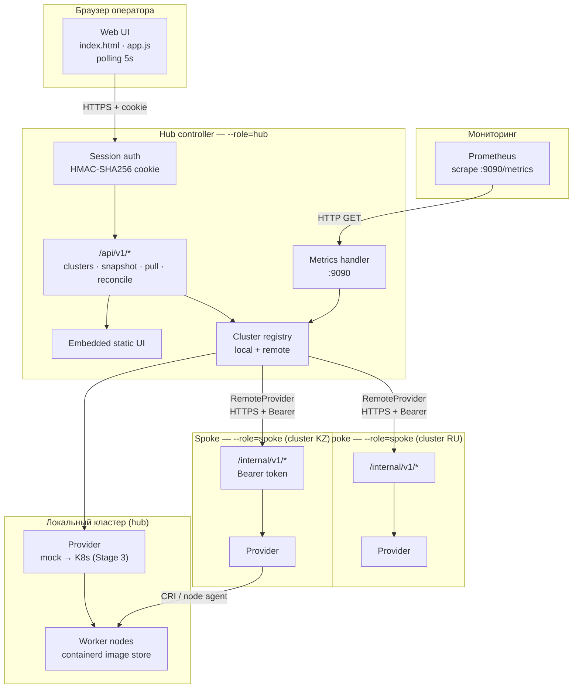
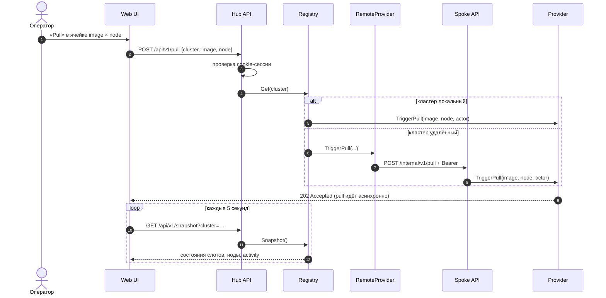
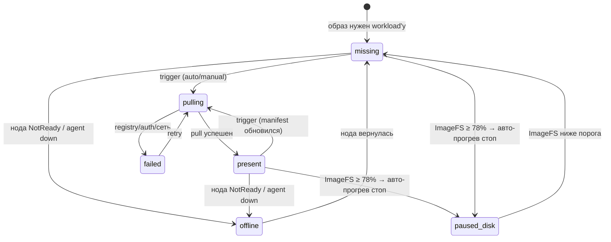

# Image Prepuller

Консоль и API для прогрева image-кэша на worker-нодах Kubernetes: показывает, какие образы
из workload'ов реально лежат на каждой ноде, позволяет дотянуть недостающие, следит за
заполнением ImageFS и отдаёт метрики Prometheus для multi-cluster контура.

> Текущее состояние — **Stage 1 (mock)**: работают Web UI, авторизация, multi-cluster реестр,
> headless spoke API и Prometheus-метрики на in-memory провайдере. Живой Kubernetes/CRI
> провайдер и node-agent появятся в Stage 2–3 (см. [Roadmap](#roadmap)).

## Что умеет

- **Workloads view** — Deployment / StatefulSet / DaemonSet, их образы (включая init-контейнеры),
  PullPolicy, покрытие каждого образа по нодам.
- **Матрица image × node** — состояние каждого слота: `present`, `pulling`, `missing`,
  `failed`, `paused_disk`, `offline`; размер, время последней проверки, текст ошибки.
- **Ручной прогрев** — отдельный слот (image + node) или все образы workload'а сразу на все
  онлайн-ноды.
- **Nodes view** — ImageFS (used/capacity), порог паузы авто-прогрева (78%) и порог kubelet GC
  (85%), активные pull'ы, список закэшированных образов.
- **Policy warnings** — `:latest`/отсутствие иммутабельного тега и `imagePullPolicy: Always`
  (ломают offline failover).
- **Activity** — журнал pull-событий с триггером (auto / manual + логин), длительностью и ошибкой.
- **Multi-cluster** — hub агрегирует локальный и удалённые spoke-кластеры через единый интерфейс.
- **Prometheus** — отдельный порт `:9090/metrics`, метрики по кластерам, нодам, слотам и pull'ам.

## Архитектура

Сервис — один бинарь с двумя ролями. Hub даёт Web UI и публичный API с cookie-сессией;
spoke — headless-бэкенд рядом с кластером, общается с hub по Bearer-токену.



Пунктиром мысленно отметьте то, чего пока нет: CRI-вызовы и node-agent — Stage 2/3,
сейчас всё это заменяет `MockProvider`.

### Поток ручного прогрева



### Жизненный цикл образа на ноде



Полная схема компонентов, режимы hub/spoke и модель данных — в
[docs/architecture.md](docs/architecture.md).

## Быстрый старт

Нужен только Go (модуль без внешних зависимостей, только stdlib).

```bash
# сборка
go build -o bin/prepuller ./cmd/prepuller

# hub + Web UI на http://localhost:8080 в mock-режиме
export PREPULLER_AUTH_USER=admin
export PREPULLER_AUTH_PASS=admin
export PREPULLER_SESSION_SECRET="$(openssl rand -hex 32)"   # иначе секрет генерится на старте
./bin/prepuller controller -role=hub -mock

# отдельно — headless spoke
export PREPULLER_CLUSTER_TOKEN=spoke-secret
./bin/prepuller controller -role=spoke -mock -http-addr=:8081 -cluster-name=talos-prod-kz
```

Откройте http://localhost:8080, войдите под `PREPULLER_AUTH_USER` / `PREPULLER_AUTH_PASS`.
В mock-режиме поднимаются три кластера: `talos-prod-eu` (hub), `talos-prod-kz`,
`talos-stage-ru`; у `talos-worker-03` ImageFS заполнен на 80% (пауза авто-прогрева),
`talos-worker-04` — NotReady, часть образов в статусе `failed` / `paused_disk`.

### Проверка

```bash
curl -s localhost:8080/healthz                 # ok
curl -s localhost:8080/readyz                  # ok
curl -s localhost:9090/metrics | head
curl -s -c /tmp/pc -X POST localhost:8080/api/v1/auth/login \
  -H 'Content-Type: application/json' \
  -d '{"username":"admin","password":"admin"}'
curl -s -b /tmp/pc localhost:8080/api/v1/clusters | jq
curl -s -b /tmp/pc 'localhost:8080/api/v1/snapshot?cluster=talos-prod-kz' | jq '.summary'
```

## Флаги

| Флаг | По умолчанию | Назначение |
| --- | --- | --- |
| `-role` | `hub` | `hub` — Web UI + API + auth; `spoke` — headless backend API |
| `-http-addr` | `:8080` | Адрес HTTP (UI/API) |
| `-metrics-addr` | `:9090` | Адрес Prometheus-метрик (только `GET /metrics`) |
| `-mock` | `false` | In-memory провайдер, Kubernetes не нужен |
| `-cluster-name` | `talos-prod-eu` | Имя локального кластера |

Подкоманда `agent` зарезервирована под Stage 2 (CRI `/run/containerd/containerd.sock`)
и пока завершается с сообщением об ошибке.

## Переменные окружения

| Переменная | Роль | Обязательна | Описание |
| --- | --- | --- | --- |
| `PREPULLER_AUTH_USER` | hub | да | Логин оператора (единственный статический пользователь) |
| `PREPULLER_AUTH_PASS` | hub | да | Пароль оператора |
| `PREPULLER_SESSION_SECRET` | hub | нет | Ключ подписи cookie; без него генерируется случайный (сессии живут до рестарта) |
| `PREPULLER_CLUSTER_TOKEN` | spoke | нет | Bearer-токен для `/internal/v1/*`; пустое значение = API без авторизации |
| `PREPULLER_REMOTE_CLUSTERS` | hub | нет | Дополнительные spoke: `name=url=token,name2=url2=token2` |

## HTTP API

Все защищённые ручки hub требуют cookie `prepuller_session` (HttpOnly, SameSite=Lax,
`Secure` при TLS или `X-Forwarded-Proto: https`). Health-ручки открыты.

| Метод и путь | Доступ | Описание |
| --- | --- | --- |
| `GET /healthz` | открыт | Liveness, `ok` |
| `GET /readyz` | открыт | Readiness, `ok` |
| `POST /api/v1/auth/login` | открыт | `{username,password}` → ставит cookie |
| `POST /api/v1/auth/logout` | открыт | Сбрасывает cookie |
| `GET /api/v1/auth/me` | cookie | `{username}` или 401 |
| `GET /api/v1/clusters` | cookie | `{defaultCluster, clusters[]}` |
| `GET /api/v1/snapshot?cluster=ID` | cookie | Полный снимок кластера (`model.Snapshot`) |
| `POST /api/v1/pull` | cookie | `{cluster,image,node}` → 202 |
| `POST /api/v1/workloads/pull` | cookie | `{cluster,namespace,kind,name}` → 202 `{triggered}` |
| `POST /api/v1/reconcile` | cookie | `{cluster}` → 200, принудительный синк |

Spoke (только если задан `PREPULLER_CLUSTER_TOKEN` — Bearer):

| Метод и путь | Описание |
| --- | --- |
| `GET /internal/v1/snapshot` | Снимок кластера |
| `POST /internal/v1/pull` | `{image,node,actor}` → 202 |
| `POST /internal/v1/workloads/pull` | `{namespace,kind,name,actor}` → 202 `{triggered}` |
| `POST /internal/v1/reconcile` | `{actor}` → 200 |

## Метрики

Экспортируются на отдельном порту (`-metrics-addr`, по умолчанию `:9090`) в текстовом
формате Prometheus:

| Метрика | Тип | Метки |
| --- | --- | --- |
| `prepuller_cluster_up` | gauge | `cluster`, `role` |
| `prepuller_image_present` | gauge | `cluster`, `namespace`, `workload_kind`, `workload_name`, `image`, `node` |
| `prepuller_workload_policy_violation` | gauge | те же + `reason` |
| `prepuller_node_agent_up` | gauge | `cluster`, `node` |
| `prepuller_node_disk_paused` | gauge | `cluster`, `node` |
| `prepuller_node_imagefs_used_bytes` | gauge | `cluster`, `node` |
| `prepuller_node_imagefs_capacity_bytes` | gauge | `cluster`, `node` |
| `prepuller_pull_total` | counter | `cluster`, `image`, `node`, `result` |

У удалённых кластеров `prepuller_pull_total` пока пуст: `RemoteProvider.PullCounters()`
возвращает `nil`.

## Структура репозитория

```
cmd/prepuller/          точка входа, разбор подкоманд и флагов, запуск/graceful shutdown
internal/auth/          cookie-сессии: HMAC-SHA256, constant-time сравнение, TTL
internal/model/         доменные типы и JSON-контракт API (Snapshot, Workload, NodeInfo, …)
internal/provider/      Provider interface, MockProvider, RemoteProvider, Registry
internal/web/           hub- и spoke-роутеры, auth-middleware, embed статики
internal/web/static/    index.html, app.js, styles.css — без сборки и npm
internal/metrics/       ручная генерация Prometheus text exposition
```

## Разработка

```bash
go test ./...            # тесты auth и web (роутинг, 401, cookie, метрики)
go vet ./...
gofmt -l .
go build -o bin/prepuller ./cmd/prepuller
```

В рабочем каталоге лежит локальный `.gocache/` — если `GOCACHE` не задан глобально,
используйте `GOCACHE=$PWD/.gocache go test ./...`. Правила и инварианты для агентов —
в [AGENTS.md](AGENTS.md).

## Roadmap

Подробный план работ с разбивкой на параллельные потоки, зоны записи и порядок мержа —
в [docs/PLAN.md](docs/PLAN.md).

| Этап | Содержание |
| --- | --- |
| Stage 1 (готово) | Mock-провайдер, hub/spoke, Web UI, auth, multi-cluster, метрики |
| Stage 2 | `agent`-режим: gRPC/HTTP к CRI containerd, реальный pull, инвентаризация образов на ноде |
| Stage 3 | `K8sProvider`: список workload'ов через API, состояния слотов с нод, фоновый reconciler и авто-прогрев |
| Далее | RBAC/несколько пользователей, аудит-лог, Helm-чарт, алерты по покрытию и ImageFS |

## Известные ограничения

- Один статический пользователь, без rate-limit и блокировки после неудачных попыток.
- Автоматический prepull-цикл не реализован: `SyncNow` только обновляет `lastSeen`/`lastChecked`
  в mock-провайдере; реальная сверка появится в Stage 3.
- `Missing` в mock не возникает: все слоты инициализируются `present`/офлайн/паузой.
- Один экземпляр hub: состояние (сессии, реестр) in-memory, реплики не разделяют данные.
- Hub при старте без `-mock` завершается с `live Kubernetes provider is Stage 3` — это
  ожидаемое поведение, а не сломанная конфигурация.
