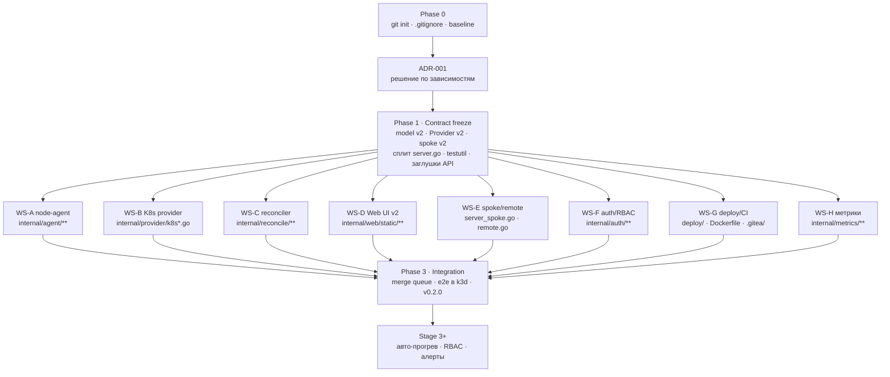
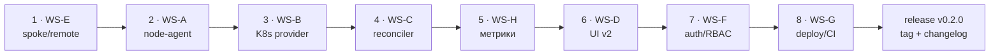

# План работ: Stage 2–3 и параллельные агентские сессии

Документ описывает, как вести проект от текущего состояния (Stage 1, mock) к живым
кластерам, разбив работу на **независимые рабочие потоки (workstreams)** так, чтобы
несколько агентских сессий могли работать одновременно **в отдельных git worktree**
и не конфликтовать друг с другом.

Базовые правила поведения агента — в [AGENTS.md](../AGENTS.md), архитектура —
в [architecture.md](architecture.md), решения по зависимостям —
в [ADR-001](adr/0001-dependencies.md).

**Статус на 2026-11-26:** Phase 0 выполнена (git, baseline `18aaaa5`, артефакты
в `.gitignore`); ADR-001 **Accepted** (grpc+cri-api в агенте, client-go в K8s-провайдере,
GOPROXY-зеркало вместо vendor); Phase 1 (contract freeze) выполнена и помечена тегом
`contract-v2`.

**Phase 2 — в работе.** В `integ/stage-2` уже слиты и проверены гейтами плюс ревью:
WS-A (node-agent: CRI, инвентарь, HTTP/JSON API v1), WS-B (K8sProvider на client-go,
TTL-кэш, слоты), WS-C (reconciler + флаг `-auto-warm` в main), WS-H (метрики: один
Snapshot на скрейп + новые серии), WS-D (UI v2: Pull Tasks, панель ноды). В работе:
WS-E (spoke/remote), WS-B2 (транспорт K8sProvider ↔ агент), WS-F (auth/RBAC),
WS-G (Dockerfile/Helm/CI). Отклонение от порядка мержа §9: E отставал по времени,
поэтому A/B/C/H/D влиты первыми — зоны не пересекаются, конфликтов не было.

## 1. Цели этапов

| Этап | Цель | Критерий готовности |
| --- | --- | --- |
| Stage 2 | node-agent + CRI: реальный pull и инвентаризация образов на ноде | агент поднимается в k3d, видит образы containerd, выполняет pull по запросу, отдаёт размеры и ImageFS |
| Stage 3 | K8sProvider + reconciler | hub показывает реальные Deployment/STS/DS и слоты, автоматически догревает недостающее с учётом диска, e2e-тест в CI |
| После Stage 3 | эксплуатация | Helm-чарт, CI/CD, RBAC/несколько пользователей, алерты, аудит |

## 2. Точка отсчёта

Готово (Stage 1): hub/spoke, cookie-auth, mock-провайдер, multi-cluster, Web UI,
8 семейств метрик, тесты auth/web, документация.

Не готово и определяет план:

- ~~нет git-репозитория~~ → **закрыто в Phase 0** (2026-11-26: baseline-коммит, worktree доступны);
- нет node-agent (подкоманда agent — заглушка);
- нет живого K8s/CRI провайдера (-mock обязателен);
- нет автоматического цикла сверки/прогрева;
- нет деплоя (Dockerfile, Helm), CI и e2e;
- нулевые внешние зависимости — придётся осознанно решить, что добавляем (ADR-001).

## 3. Фаза 0 — предусловия (блокирует всё)

Выполняется один раз, последовательно, **до** создания worktree.

```bash
git init -b main
printf '%s\n' 'bin/' '.gocache/' '*.log' '.DS_Store' > .gitignore
git add -A && git commit -m "chore: baseline stage 1 (docs + mock hub/spoke)"
```

Правила:

- .gocache/ (138 МБ), .gopath/ (модульный кэш) и bin/ — в .gitignore, в историю не попадают.
- **Worktree создаются внутри репозитория** (в песочнице DSH писать можно только в
  workspace): `git worktree add .worktrees/ip-<ws> -b ws/<ws>` от main;
  `.worktrees/` в .gitignore. Путь `../ip-<ws>` из ранней версии плана в песочнице
  не работает — он вне workspace.
- Сборка в worktree: `export GOCACHE=$PWD/.gocache GOPATH=$PWD/.gopath
  GOMODCACHE=$PWD/.gopath/pkg/mod` (общий `$HOME`-кэш в песочнице read-only),
  затем `go mod download` — с contract-v2 у модуля есть внешние зависимости.
- Ветки живут ≤ 3 дней; ежедневно git rebase main.

После baseline фиксируем в репозитории два артефакта: этот план и ADR-001 с решением
по зависимостям.

## 4. Фаза 1 — Contract freeze (последовательная, один владелец)

Параллельная работа ломается не на коде, а на контрактах. Поэтому все общие файлы
меняются **один раз, до** ветвления, одним PR от интегратора (роль lead).

Состав PR (behavior-neutral, кроме новых полей):

1. **[ADR-001 «Зависимости Stage 2/3»](adr/0001-dependencies.md).** Решение и границы:
   - internal/agent — google.golang.org/grpc + k8s.io/cri-api;
   - internal/provider/k8s*.go — k8s.io/client-go (или stdlib REST-клиент, если
     решим сохранить zero-dep; тогда TTL-кэш и list-watch пишем сами);
   - internal/auth — golang.org/x/crypto только при переходе на несколько пользователей;
   - правило: **новые зависимости допустимы только в новых пакетах и только по ADR**;
     go.mod/go.sum — зона интегратора, не feature-ветки.
2. **Сплит общих файлов**, чтобы зоны записи стали непересекающимися:
   - internal/web/server.go → server.go (сборка mux, hub-хендлеры) +
     server_spoke.go (spoke-роутер);
   - requireAuth → internal/auth/middleware.go;
   - cmd/prepuller/main.go теряет заглушку agent и вызывает runAgent() из
     cmd/prepuller/agent.go (там же — заглушка, файл дальше принадлежит WS-A).
3. **model v2** (аддитивно): ImageRef{Image,Digest,Tag}, типизированный PullPolicy,
   NodeInfo.AgentVersion/Conditions, PullTask{ID,State,Attempt,Error},
   Snapshot.LastSyncAt/SyncStatus/Partial, PullEvent.Actor/Trigger как enum.
4. **Provider v2** (один интерфейс, обновляются сразу все реализации):
   Snapshot, TriggerPull(ctx, PullRequest) (PullTask, error), CancelPull,
   SyncNow, Health(ctx), PullCounters. Mock/remote/k8s-заглушка + тесты в том же PR.
5. **Spoke API v2** — аддитивно к /internal/v1: GET /internal/v1/counters,
   POST /internal/v1/pulls/{id}/cancel; RemoteProvider учится их вызывать.
6. **Hub API** — заглушки новых ручек, чтобы UI можно было делать параллельно:
   GET /api/v1/pull-tasks, GET /api/v1/nodes/{node}/images, GET /api/v1/events (SSE, опционально).
7. **internal/testutil** — общий фейк spoke (httptest), фикстуры снапшотов, хелперы.
8. **CI-каркас** .gitea/workflows/ci.yaml (gofmt/vet/test/build) — пока без e2e.

После мержа: тег `contract-v2`, от него режутся все рабочие ветки, а интегратор
создаёт себе долгоживущее дерево (внутри репозитория — см. §3):

```bash
git worktree add .worktrees/ip-lead -b integ/stage-2 contract-v2
```

**Выполнено (2026-11-26):** сплит `server.go`/`server_spoke.go`, `auth/middleware.go`,
`runAgent()` + `internal/agent` скелет, model v2, Provider v2, spoke v2 (counters/cancel),
заглушки hub-API, `internal/testutil` (fake spoke + golden v2 + контрактные тесты),
`.gitea/workflows/ci.yaml`, зависимости по ADR-001. Тег `contract-v2`.

> Длительность: 2–3 агентских дня. Это единственная последовательная фаза; всё
> остальное распараллеливается.

## 5. Рабочие потоки (WS)

| WS | Что делает | Зона записи (эксклюзивно) | Зависит от | Оценка |
| --- | --- | --- | --- | --- |
| **A** node-agent | gRPC-сервер агента, CRI-клиент containerd, инвентарь образов, PullImage, ImageFS-статистика, пауза по порогу | internal/agent/**, cmd/prepuller/agent.go | ADR-001, contract | 5–7 д |
| **B** K8s provider | list Deployments/STS/DS + init-контейнеры, ImagePullSecrets, слоты из ответов агентов, TTL-кэш снапшота | internal/provider/k8s*.go | ADR-001, contract | 4–6 д |
| **C** reconciler | политика авто-прогрева: очередь, приоритеты, параллелизм, backoff, disk-guard, идемпотентность | internal/reconcile/** | contract (Provider v2) | 4–6 д |
| **D** Web UI v2 | pull-tasks, live-статусы, SSE/поллинг, фильтры, доступность; только статика | internal/web/static/** | contract (заглушки API) | 3–5 д |
| **E** spoke + remote | counters, cancel, таймауты/ретраи, health spoke, контрактные тесты hub↔spoke | internal/web/server_spoke.go, internal/provider/remote.go | contract | 2–3 д |
| **F** auth/RBAC | несколько пользователей, роли viewer/operator, rate-limit логина, аудит-лог действий | internal/auth/** | contract (middleware вынесен) | 3–4 д |
| **G** deploy/CI | Dockerfile (multi-stage), Helm-чарт (hub/spoke/agent DaemonSet), .gitea/workflows, docs/DEPLOY.md | deploy/**, Dockerfile, .gitea/**, docs/DEPLOY.md | contract (порты/health) | 3–5 д |
| **H** метрики | новые серии: очередь/выполнение pull, last sync, free bytes, build info; кэш снапшота на скрейп | internal/metrics/** | contract | 2–3 д |

Зоны записи A–H не пересекаются. Общие файлы (model, registry, provider.go,
main.go, server.go, README, AGENTS.md, docs/architecture.md, go.mod) —
**только интегратор**.

### 5.1 Граф зависимостей



## 6. Правила параллельной работы

1. **Один файл — один владелец.** Владелец зоны из таблицы §5. Если нужна правка
   чужой зоны — задача интегратору, а не «быстрый фикс».
2. **Contract freeze неприкосновенен.** После contract-v2 любое изменение model/
   Provider — отдельный contract PR: остальные ветки ставятся на паузу, ветки
   ребейзятся после мержа. Не чаще одного раза за фазу.
3. **Документация — только интегратор.** README/AGENTS/architecture в feature-ветках
   не правятся; WS сдаёт «doc snippet» в описании PR (раздел, строки, текст).
   Исключение — docs/DEPLOY.md (WS-G).
4. **go.mod/go.sum — только интегратор.** Новая зависимость = ADR + contract PR;
   остальные после ребейза делают go mod download и проверяют сборку.
5. **Не переформатировать чужие файлы.** gofmt -l только по своим файлам:
   gofmt -l $(git diff --name-only main... -- '*.go'). Команда gofmt -w ./...
   ломает параллельные ветки.
6. **Контрактные тесты вместо договорённостей.** Всё, что пересекает границу
   hub↔spoke и provider↔UI, проверяется в internal/testutil/контрактных тестах,
   а не устно.
7. **Мелкие PR.** Один WS — один PR (или серия ≤ 6 файлов логики + тесты). Большой PR
   держит merge queue и мешает остальным.
8. **Ежедневный ребейз.** git fetch && git rebase origin/main; конфликты решает
   автор ветки, не интегратор.
9. **Ветка не живёт без зелёных гейтов** дольше суток — иначе она превращается в
   второй main.

### 6.1 Гейты для каждой ветки

```bash
go build ./...
go vet ./...
go test ./...
gofmt -l $(git diff --name-only main... -- '*.go')     # пусто
go list -m all | diff - <(git show main:go.mod)          # новых зависимостей нет
```

Плюс в описании PR: doc snippet, список затронутых чужих зон (должен быть пустым),
как проверялось вручную (-mock/k3d).

## 7. Роли сессий

| Роль | Ветка/worktree | Ответственность |
| --- | --- | --- |
| lead (root) | main | контракт, ревью, merge queue, документация, релиз; не пишет feature-код |
| ws-a-node-agent | ../ip-a-node | internal/agent/** |
| ws-b-kube | ../ip-b-kube | internal/provider/k8s*.go |
| ws-c-reconcile | ../ip-c-reconcile | internal/reconcile/** |
| ws-d-ui | ../ip-d-ui | internal/web/static/** |
| ws-e-spoke | ../ip-e-spoke | spoke + remote |
| ws-f-auth | ../ip-f-auth | internal/auth/** |
| ws-g-ops | ../ip-g-ops | deploy/CI |
| ws-h-metrics | ../ip-h-metrics | internal/metrics/** |

Рекомендуемое число одновременных сессий: **4–5**. При 8+ сессиях выигрыш съедается
интеграцией и ревью. Волна 1: A, B, C, D (самые длинные). Волна 2: E, F, G, H
(короткие, стартуют после первого мержа волны 1).

Каждая задача на общем борде создаётся с write_scopes и blocked_by:

| Задача | blocked_by | write_scopes |
| --- | --- | --- |
| WS-0 baseline+git | — | .gitignore |
| WS-1 ADR-001+contract | WS-0 | go.mod, internal/model, internal/provider, internal/web, cmd/prepuller, internal/testutil |
| WS-A node-agent | WS-1 | internal/agent, cmd/prepuller/agent.go |
| WS-B k8s provider | WS-1 | internal/provider/k8s |
| WS-C reconciler | WS-1 | internal/reconcile |
| WS-D UI v2 | WS-1 | internal/web/static |
| WS-E spoke/remote | WS-1 | internal/web/server_spoke.go, internal/provider/remote.go |
| WS-F auth/RBAC | WS-1 | internal/auth |
| WS-G deploy/CI | WS-1 | deploy, Dockerfile, .gitea, docs/DEPLOY.md |
| WS-H metrics | WS-1 | internal/metrics |
| WS-INT integration | A–H | README.md, AGENTS.md, docs/architecture.md |

## 8. Фазы и календарь

Оценки — в агентских днях; календарь при 4 параллельных сессиях.

| Фаза | Содержание | Длительность |
| --- | --- | --- |
| 0 | git, .gitignore, baseline — **выполнено** (`18aaaa5`) | 0.5 д |
| 1 | ADR-001 + contract freeze (последовательно) — **выполнено** (тег `contract-v2`) | 2–3 д |
| 2 | Параллельно WS-A/B/C/D, затем E/F/G/H — **в работе** (A/B/C/D/H в `integ/stage-2`) | 5–8 д (календарно) |
| 3 | Интеграция, e2e в k3d, docs, релиз v0.2.0 | 2–3 д |
| 4 | Stage 3: авто-прогрев в бою, RBAC, алерты | 8–12 д |

Итого до v0.2.0 (живые кластеры, агент, reconciler): **≈ 2 недели** при 4 сессиях.

## 9. Порядок интеграции и релиз

Мерж строго по одному, после ребейза и повторного прогона гейтов на integ/stage-2:



Почему так: E закрывает транспорт, без которого не проверить live-источники; A даёт
данные, B их агрегирует, C начинает догревать; H фиксирует новые сигналы; D показывает
результат; F и G — эксплуатационная обвязка, их мерж не блокирует код.

E2E-сценарий Stage 2/3 (обязателен перед релизом):

1. k3d cluster create + docker build образа.
2. Helm install: hub + agent DaemonSet на 2 ноды.
3. Задеплоить тестовый workload с образом :latest и Always → в UI два policy-warning.
4. Удалить образ с одной ноды → в UI слот missing, авто-прогрев возвращает present.
5. Занять ImageFS выше 78% → слот paused_disk, в логах пауза, метрика prepuller_node_disk_paused=1.
6. Убить агента на ноде → offline, hub не падает, кластер помечен offline в списке.
7. curl /metrics — новые серии присутствуют; go test ./... зелёный в CI.

## 10. Контракт Stage 2 (что фиксируем в Phase 1)

| Область | Добавляем | Кто потребляет |
| --- | --- | --- |
| model | ImageRef, PullTask, NodeInfo.AgentVersion/Conditions, Snapshot.LastSyncAt/SyncStatus/Partial, PullEvent.Actor | A, B, C, D, H |
| Provider | TriggerPull(ctx, PullRequest) (PullTask, error), CancelPull, Health | A, B, C, E, H |
| Spoke API | /internal/v1/counters, /internal/v1/pulls/{id}/cancel | E |
| Hub API | /api/v1/pull-tasks, /api/v1/nodes/{node}/images, SSE /api/v1/events | D |
| Метрики | prepuller_pull_tasks_queued, ..._running, prepuller_sync_last_success_timestamp_seconds, prepuller_node_imagefs_free_bytes, prepuller_agent_build_info | H, G |

Правило совместимости: hub обновляется **раньше** spoke; spoke обязан принимать
старый и новый формат один релиз (поле apiVersion в запросах агента/споука).

## 11. Риски

| Риск | Влияние | Мера |
| --- | --- | --- |
| Появление зависимостей ломает «zero-dep» и офлайн-сборку | высокая | ADR-001 до ветвления; go mod vendor или зеркало proxy в CI; зависимости только в internal/agent, internal/provider/k8s* |
| Contract thrash: D/B/C стартуют на нестабильном model | высокая | contract-v2 тег + обязательный ребейз; contract PR ≤ 1 за фазу |
| Конфликты в model/README между сессиями | средняя | правило «один владелец зоны», документы — только интегратор |
| CRI нельзя поднять в CI | средняя | фейковый CRI-сервер в internal/testutil, e2e только в k3d-джобе |
| metrics.Handler ×6 Snapshot() станет дорогим на live-провайдере | средняя | кэш снапшота в провайдере (B), снятие кэша на скрейп (H) |
| Агент на ноде с правами на containerd — риск | высокая | read-only rootfs, только CRI-сокет, NetworkPolicy, ServiceAccount без прав в API |
| Медленный merge queue | низкая | мелкие PR, ежедневный ребейз, интегратор — выделенная роль |
| Расхождение mock и live | средняя | golden-фикстуры снапшотов в testutil, e2e-проверки в §9 |

## 12. Definition of Done этапа

- [ ] git-репозиторий, main защищён, все ветки через PR + гейты §6.1.
- [x] ADR-001 и contract-v2 в main; go.mod меняется только через них.
- [ ] WS-A…H смержены в порядке §9; go test ./..., go vet ./..., gofmt — чисто.
- [ ] E2E-сценарий §9 проходит в CI на k3d.
- [ ] README/AGENTS/architecture/diagrams обновлены интегратором, docs/DEPLOY.md — WS-G.
- [ ] Метрики новых серий присутствуют, описаны в README и на дашборде.
- [ ] Релиз v0.2.0: тег, changelog, образ в registry, Helm-чарт.

## 13. Первые пять действий

1. ~~git init + .gitignore + baseline-коммит~~ — **выполнено, коммит `18aaaa5`**.
2. ~~Создать worktree и задачи WS-0…WS-H на борде с write_scopes/blocked_by~~ — **выполнено**.
3. ~~Провести ревью ADR-001~~ — **Accepted**, [docs/adr/0001-dependencies.md](adr/0001-dependencies.md).
4. ~~Сделать contract PR (сплит файлов, model v2, Provider v2, testutil, заглушки API)~~ —
   **выполнено**, тег `contract-v2`.
5. Запустить волну 1 (A, B, C, D), интегратор в это время — merge queue и ревью.
