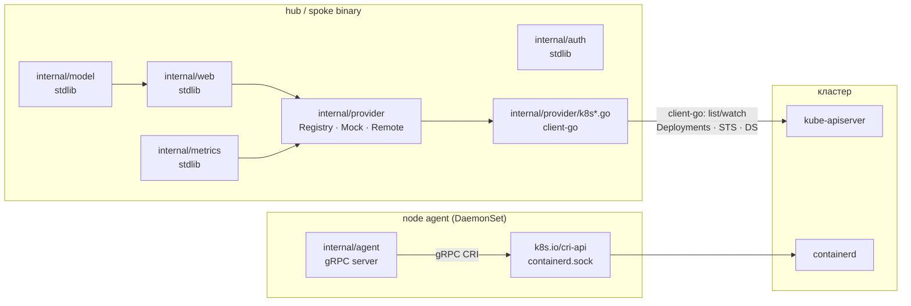

# ADR-001: Зависимости Stage 2/3 (CRI и Kubernetes API)

- **Статус:** Accepted (2026-11-26; подтверждено владельцем проекта)
- **Дата:** 2026-11-26
- **Контекст:** Stage 2/3 плана ([docs/PLAN.md](../PLAN.md) §4)
- **Затрагивает:** go.mod/go.sum, internal/agent, internal/provider/k8s*, internal/testutil, CI

## Контекст

Stage 1 сознательно собран на одной стандартной библиотеке: нет go.sum, нет
node_modules, нет шага сборки фронтенда. Это дало быструю сборку, офлайн-воспроизводимость
и бинарь без транзитивного мусора.

Stage 2/3 требуют двух вещей, которых в stdlib нет:

1. **CRI containerd** — это gRPC-сервис на /run/containerd/containerd.sock. Без
   протокола CRI агент не может ни перечислить образы с размерами, ни выполнить PullImage
   с прогрессом, ни корректно отследить ошибки реестра.
2. **Kubernetes API** — список Deployment/StatefulSet/DaemonSet, init-контейнеры,
   imagePullSecrets, метки. Это HTTPS+JSON, но с аутентификацией in-cluster
   (ServiceAccount token + CA), пагинацией, label-селекторами и (в перспективе) watch.

Одновременно действуют ограничения:

- Go 1.24 в go.mod; целевые платформы — linux/amd64 и linux/arm64;
- сборка должна оставаться воспроизводимой в CI без интернета или через зеркало proxy;
- агент запускается на каждой ноде и имеет доступ к containerd.sock — минимум кода
  и минимум зависимостей здесь принципиальны (supply chain);
- тесты не должны требовать реального кластера (фейки на httptest/фейковый CRI-сервер);
- hub не должен тянуть зависимости агента (и наоборот).

## Варианты (кратко)

| Вариант | Агент | K8s API | Итог |
| --- | --- | --- | --- |
| A. Всё через client-go | grpc + cri-api | client-go | максимум готового кода, максимум зависимостей |
| B. Чистый stdlib + crictl | бинарь crictl + парсинг вывода | свой REST-клиент | ноль зависимостей, хрупкий pull и ошибки |
| C. Гибрид без client-go | grpc + cri-api | свой REST-клиент | компактно, но +200–300 строк и нет watch |

## Решение

Принят **гибрид «A для Kubernetes + C для агента»**:

1. **Агент** (`internal/agent`) — `google.golang.org/grpc` + `k8s.io/cri-api`.
   Это единственное место, где протокол CRI неизбежен; других внешних импортов в
   `internal/agent` быть не должно.
2. **K8s-провайдер** (`internal/provider/k8s*.go`) — `k8s.io/client-go`
   (+ `k8s.io/api`, `k8s.io/apimachinery` транзитивно). Свой REST-клиент
   `internal/kube` **не пишем**: watch/информеры и пагинация берутся из client-go.
   Решение пересматривается, только если размер бинаря или supply chain станут проблемой.
3. **Hub-обвязка** (`internal/web`, `internal/model`, `internal/auth`,
   `internal/metrics`, `internal/provider/{provider,registry,mock,remote}.go`) —
   по-прежнему только stdlib. `client-go` попадает в бинарь hub транзитивно через
   пакет `internal/provider` (hub и spoke — один бинарь); это принятая цена.
4. **`vendor/` не используется.** CI и разработка тянут модули через `GOPROXY`
   (зеркало + `direct` fallback), `go.sum` коммитится. Vendor — аварийный вариант
   только для полностью офлайн-сборки, отдельным решением.
5. **Версии фиксируются в contract PR** и обновляются только интегратором:
   `k8s.io/client-go v0.33.13`, `k8s.io/cri-api v0.33.13`, `google.golang.org/grpc v1.80.0`.
   Все три совместимы с `go 1.24` (client-go v0.34+ уже требует go 1.25 — осознанно
   остаёмся на 1.24 до отдельного решения о поднятии тулчейна).
6. **go.mod/go.sum — зона интегратора**; feature-ветки их не меняют (AGENTS §11).

## Границы зависимостей

Правила импорта (проверяются на ревью и гейтом CI):

| Пакет | Разрешено |
| --- | --- |
| `internal/agent` | `google.golang.org/grpc`, `k8s.io/cri-api`, stdlib |
| `internal/provider/k8s*.go` | `k8s.io/client-go`, `k8s.io/api`, `k8s.io/apimachinery`, stdlib |
| `internal/web`, `internal/model`, `internal/auth`, `internal/metrics` | только stdlib |
| `internal/provider/{provider,registry,mock,remote}.go` | только stdlib |
| `internal/testutil` | stdlib + внутренние пакеты (фейки, без клиентов) |

## Последствия

Положительные:

- K8s-часть не пишется руками: list/watch, пагинация, типы API и ретраи — из client-go;
- агент остаётся компактным (grpc + cri-api), его поверхность атаки не растёт от K8s-стека;
- hub и агент не делят зависимости: граница проходит по пакетам и проверяется таблицей выше;
- тесты по-прежнему не требуют кластера: фейковый spoke и golden-снапшоты в `internal/testutil`,
  фейковый CRI — задача WS-A.

Отрицательные и принимаемые:

- go.sum ~180 строк и ~40 транзитивных модулей (grpc, protobuf, x/net, k8s.io/api,
  apimachinery, klog, go-openapi, …) — сборка требует модульного кэша или сети/зеркала;
- бинарь hub/spoke вырос (client-go линкуется в общий бинарь) — оценивается в CI-шаге
  `-ldflags "-s -w"`; если станет критично, K8s-провайдер выносится в отдельный бинарь;
- обновление client-go привязано к релизам Kubernetes — версии обновляет интегратор
  вместе с `go.mod`, а не feature-ветки.

Нейтральные:

- формат ошибок CRI (gRPC status) попадает в `model.PullTask.Error` — нужна нормализация
  в адаптере, чтобы UI не показывал protobuf-мусор (WS-A).

## Что сделано в contract PR (contract-v2)

- [x] `go get k8s.io/client-go@v0.33.13 k8s.io/cri-api@v0.33.13 google.golang.org/grpc@v1.80.0`,
      `go mod tidy`, `go.sum` закоммичен; `go 1.24.0` сохранён.
- [x] `internal/agent`: скелет (`Config`, `Agent.Run` — заглушка) и `DialCRI` на grpc+cri-api.
- [x] `internal/provider/k8s_stub.go`: `K8sProvider` с client-go clientset, live-методы
      возвращают `ErrNotImplemented` до WS-B.
- [x] `internal/testutil`: фейковый spoke (httptest), golden-снапшот v2, контрактные тесты.
- [x] CI: `.gitea/workflows/ci.yaml` — `GOPROXY` зеркало, `go build/vet/test`, gofmt,
      сборка под linux/amd64 и linux/arm64; `vendor/` нет.
- [x] Зафиксировано в AGENTS §3 (правила импорта) и docs/PLAN.md §4.

## Compliance

- Новая зависимость без ADR — блокирующий комментарий ревью.
- Импорт client-go вне `internal/provider/k8s*.go` — нарушение ADR-001.
- Импорт внешних пакетов в `internal/agent` кроме grpc/cri-api — нарушение.
- Импорт внешних пакетов в `internal/web|model|auth|metrics` — нарушение.
- Проверка в CI: `go list -m all` сверяется с ожидаемым списком (гейт docs/PLAN.md §6.1).

## Обновление (2026-11-26): go 1.26 и патчи безопасности

Dependabot после публикации v0.2.0 сообщил об уязвимостях в графе модулей. Разбор через
`govulncheck ./...` (v1.10.0, база vuln.go.dev 2026-11-24) показал 10 достижимых
уязвимостей в трёх модулях: `golang.org/x/net` (HTTP/2 в net/http: гонка HPACK,
двойной возврат flow-control, раздувание окна и другие DoS), `google.golang.org/grpc` (2)
и `golang.org/x/text` (1).

Исправленные версии требуют более свежего тулчейна, поэтому решение, зафиксированное
выше, обновлено:

- `go` в `go.mod`: `1.24.0` → `1.26.0` (требование `golang.org/x/net` v0.62.0);
- `google.golang.org/grpc`: v1.80.0 → v1.83.2;
- `golang.org/x/net`: v0.49.0 → v0.62.0 (транзитивно подтянуты x/text, x/sys, x/term,
  x/oauth2, genproto/rpc);
- `Dockerfile`: builder `golang:1.26-alpine`; CI читает версию из `go.mod`
  (`go-version-file`), правок не потребовалось.

Границы ADR не изменились: новых импортов в код нет, обновлены только уже разрешённые
зависимости. Контроль регрессий — шаг `govulncheck` в CI (оба workflow, пин `v1.10.0`),
база проверяется на каждом прогоне.

После обновления `govulncheck ./...` не находит ни достижимых уязвимостей, ни
проблемных модулей («No vulnerabilities found»).

Побочный эффект обновления: в графе модулей (`go list -m all`, 100 → 106 записей)
появились `cloud.google.com/go/auth`, `github.com/felixge/httpsnoop`,
`github.com/google/s2a-go`, `github.com/googleapis/enterprise-certificate-proxy`,
`github.com/googleapis/gax-go/v2`, `go.opentelemetry.io/contrib/instrumentation/net/http/otelhttp`.
Это требование `golang.org/x/oauth2` v0.36.0 (его тянет client-go), а не новый импорт:
`go list -deps ./...` их не содержит, в бинарь они не попадают, `vendor/` по-прежнему нет.
