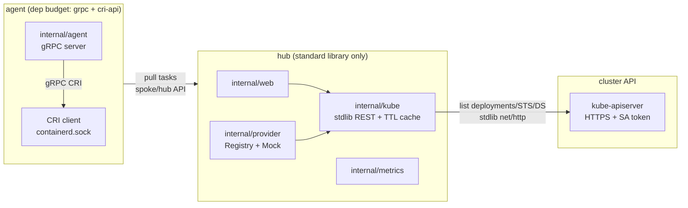

# ADR-001: Зависимости Stage 2/3 (CRI и Kubernetes API)

- **Статус:** Proposed (ждёт подтверждения; после ревью — Accepted)
- **Дата:** 2026-11-26
- **Контекст:** Stage 2/3 плана ([docs/PLAN.md](../PLAN.md) §4)
- **Затрагивает:** go.mod/go.sum, internal/agent, internal/provider/k8s*, internal/testutil, CI

## Контекст

Stage 1 сознательно собран на одной стандартной библиотеке: нет go.sum, нет
node_modules, нет шага сборки фронтенда. Это дало быструю сборку, офлайн-воспроизводимость
и бинарь без транзитивного мусора.

Stage 2/3 требуют двух вещей, которых в stdlib нет:

1. **CRI containerd** — это gRPC-сервис на /run/containerd/containerd.sock. Без
   протокола CRI агент не может ни перечислить образы с размерами, ни выполнить PullImage
   с прогрессом, ни корректно отследить ошибки реестра.
2. **Kubernetes API** — список Deployment/StatefulSet/DaemonSet, init-контейнеры,
   imagePullSecrets, метки. Технически это обычный HTTPS+JSON, но с аутентификацией
   in-cluster (ServiceAccount token + CA), пагинацией и label-селекторами.

Одновременно действуют ограничения:

- Go 1.24 в go.mod; целевые платформы — linux/amd64 и linux/arm64;
- сборка должна оставаться воспроизводимой в CI без интернета или через зеркало proxy;
- агент запускается на каждой ноде и имеет доступ к containerd.sock — минимум кода
  и минимум зависимостей здесь принципиальны (supply chain);
- тесты не должны требовать реального кластера (фейки на httptest/фейковый CRI-сервер);
- hub не должен потяжелеть из-за зависимостей агента.

## Драйверы решения

| Драйвер | Вес | Комментарий |
| --- | --- | --- |
| Безопасность агента (supply chain, поверхность атаки) | высокий | меньше кода — меньше CVE на ноде |
| Скорость и воспроизводимость сборки | высокий | офлайн/зеркало, детерминированный образ |
| Трудоёмкость Stage 2/3 | средний | client-go экономит недели на watch/информерах |
| Размер и качество тестов без кластера | средний | фейки проще на stdlib-клиенте |
| Долгосрочная поддержка (обновления API) | средний | client-go обновляется вместе с K8s |

## Варианты

### Вариант A: «Всё через client-go»

k8s.io/client-go + k8s.io/api + google.golang.org/grpc + k8s.io/cri-api.

- Плюсы: информеры, watch, кэш, ретраи, типы API «из коробки»; меньше собственного кода.
- Минусы: десятки модулей в go.sum, тяжёлый бинарь, обновления client-go ломают сборку,
  агент тянет весь стек K8s на ноду; CRI всё равно требует grpc/cri-api.

### Вариант B: «Чистый stdlib, агент через crictl»

K8s API — свой REST-клиент на stdlib; агент вместо CRI-протокола вызывает containerd-хост
через собранный в образ бинарь crictl и парсит вывод.

- Плюсы: ноль зависимостей, крошечный бинарь, минимум supply chain.
- Минусы: парсинг CLI-вывода хрупок; прогресс pull и структурированные ошибки теряются;
  в образ надо класть crictl (дополнительный бинарь и его обновления); невозможно
  аккуратно отменить pull; диагностика деградирует до текста stderr.

### Вариант C (рекомендуется): «Гибрид с бюджетом зависимостей»

- Агент: grpc + k8s.io/cri-api — единственное место, где протокол неизбежен.
- Hub/K8s: собственный REST-клиент на stdlib в новом пакете internal/kube, за
  интерфейсом WorkloadSource; client-go можно подключить позже, не меняя потребителей.
- Hub не импортирует пакеты агента: граница проходит по internal/agent и
  internal/provider/k8s*, которые связываются только через model и Provider.
- go.mod получает первую внешнюю зависимость — осознанно и один раз, в contract PR.

Бюджет: ~15–25 транзитивных модулей (grpc: x/net, x/sys, x/text, protobuf, genproto;
cri-api: k8s.io/apimachinery) против ~70–100 у client-go.

## Решение

Принимается **вариант C** со следующими границами:

## Границы зависимостей

1. internal/agent имеет право импортировать google.golang.org/grpc и k8s.io/cri-api.
   Других внешних импортов в нём быть не должно.
2. internal/kube (новый пакет) реализуется на stdlib: net/http, crypto/tls,
   encoding/json; in-cluster конфиг из /var/run/secrets/kubernetes.io/serviceaccount/
   (token, ca.crt, namespace); пагинация limit/continue; ретраи с backoff.
3. internal/provider/k8s*.go использует internal/kube, но не client-go.
4. client-go не вводится. Если появится потребность в watch/информерах, она закрывается
   polling+TTL-кэшем; переход на client-go — отдельный ADR за интерфейсом WorkloadSource.
5. Транзитивные зависимости фиксируются в contract PR (go get + go mod tidy), go.sum
   коммитится, версии проверяются на сборку linux/amd64 и linux/arm64.
6. go.mod/go.sum — зона интегратора; feature-ветки их не меняют.

## Последствия

Положительные:

- агент остаётся компактным, а hub — вообще без новых зависимостей;
- K8s-часть покрывается тестами фейковым apiserver на httptest, без kind/k3d;
- обновление клиента K8s не тянет за собой пересборку всего сервиса;
- граница internal/kube позволяет позже заменить реализацию без правок потребителей.

Отрицательные и принимаемые:

- свой REST-клиент — это код, который надо написать и протестировать (оценка ~200–300 строк
  с тестами): auth, пагинация, декодирование, ретраи;
- нет watch: изменения подхватываются polling'ом (интервал синка), для 5-секундного UI
  этого достаточно;
- grpc/cri-api в образе агента увеличивают его размер и поверхность обновлений — граница
  изолирует этот риск от hub.

Нейтральные:

- формат ошибок CRI (gRPC status) попадает в model.PullTask.Error — нужна нормализация
  в адаптер, чтобы UI не показывал protobuf-мусор.

## Что нужно сделать в contract PR

- [ ] go get google.golang.org/grpc + k8s.io/cri-api; go mod tidy; коммит go.sum.
- [ ] internal/kube: Config, Client, ListWorkloads(ctx), интерфейс WorkloadSource.
- [ ] internal/agent: заглушка gRPC-сервера с методами CRI через тот же пакет зависимостей.
- [ ] internal/testutil: фейковый apiserver (httptest + TLS) и фейковый CRI.
- [ ] CI: GOPROXY (зеркало или cache), проверка сборки под linux/amd64 и linux/arm64.
- [ ] Решение по vendor/: по умолчанию нет; включаем, если CI не имеет доступа к proxy.

## Открытые вопросы для ревью

1. **client-go сейчас или позже?** Рекомендация: позже, за интерфейсом; если нужен watch
   с первого дня — берём client-go и пересматриваем бюджет.
2. **vendor/ в репозитории или зеркало proxy в CI?** Рекомендация: зеркало; vendor —
   как аварийный вариант для офлайн-сборки.
3. **Точные версии grpc и cri-api**: выбираются в contract PR под Go 1.24 с проверкой
   сборки; фиксировать здесь конкретные номера преждевременно.

## Compliance

- Новая зависимость без ADR — блокирующий комментарий ревью.
- Импорт client-go в hub — нарушение ADR-001.
- Импорт внешних пакетов вне internal/agent (кроме будущего ADR) — нарушение.
- Проверка в CI: go list -m all сверяется с ожидаемым списком (гейт из docs/PLAN.md §6.1).
