# Архитектура Image Prepuller

Документ описывает текущую (Stage 1, mock) архитектуру и заложенные точки расширения.
Все схемы — Mermaid, рендерятся в GitHub/Gitea/GitLab и Obsidian.

## 1. Роли и топология

Один бинарь `prepuller` с двумя ролями:

| | hub | spoke |
| --- | --- | --- |
| Флаг | `-role=hub` (по умолчанию) | `-role=spoke` |
| Web UI | да (embed static) | нет |
| Авторизация | cookie-сессия оператора | Bearer-токен кластера |
| Публичный API | `/api/v1/*` | — |
| Внутренний API | — | `/internal/v1/*` |
| Кластеры | локальный + удалённые через `RemoteProvider` | ровно один локальный |
| Метрики | `:9090/metrics` по всем кластерам | `:9090/metrics` по своему |
| Требует K8s в Stage 1 | нет (`-mock`) | нет (`-mock`) |

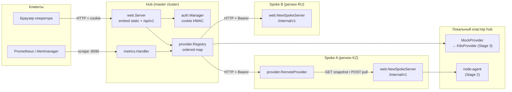

## 2. Компоненты и зависимости пакетов

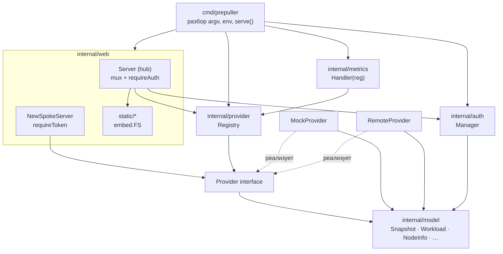

`Provider` — единственная точка расширения под Kubernetes:

```go
type Provider interface {
    Snapshot(ctx) model.Snapshot
    TriggerPull(ctx, image, node, actor string) error
    TriggerWorkloadPull(ctx, namespace, kind, name, actor string) (int, error)
    SyncNow(ctx, actor string) error
    PullCounters() []model.PullMetricSample
}
```

Hub, spoke, метрики и UI не знают, mock это или живой кластер. Поэтому новый провайдер
не требует правок ни в роутинге, ни в шаблонах метрик.

## 3. Запуск и регистрация кластеров

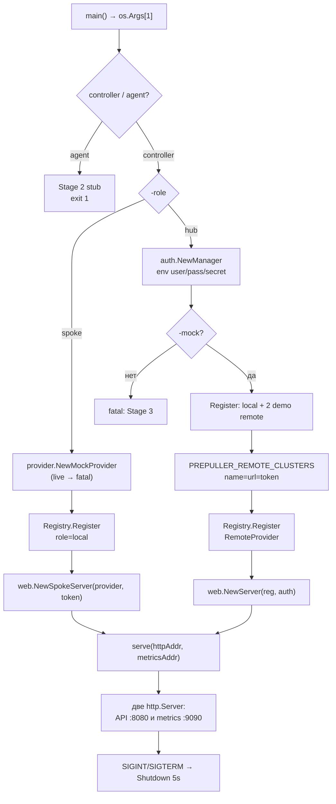

Порядок `Register` важен: `Registry.DefaultID()` — первый зарегистрированный кластер,
именно он открывается в UI по умолчанию. `AllIDs()` сортирует id, поэтому порядок
метрик стабилен и не зависит от порядка регистрации.

## 4. Аутентификация

### Hub — cookie-сессия

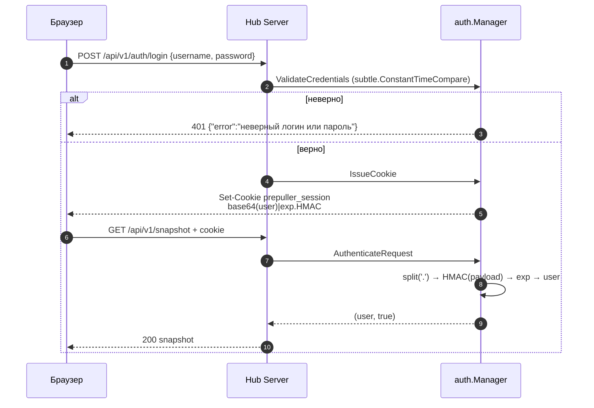

Свойства: HttpOnly, SameSite=Lax, `Secure` при TLS или `X-Forwarded-Proto: https`,
TTL 24 часа, подпись HMAC-SHA256, сравнение подписи и пароля — constant-time.
Секрет берётся из `PREPULLER_SESSION_SECRET`; если пуст — 32 случайных байта на процесс,
то есть после рестарта все сессии инвалидируются.

### Spoke — Bearer-токен

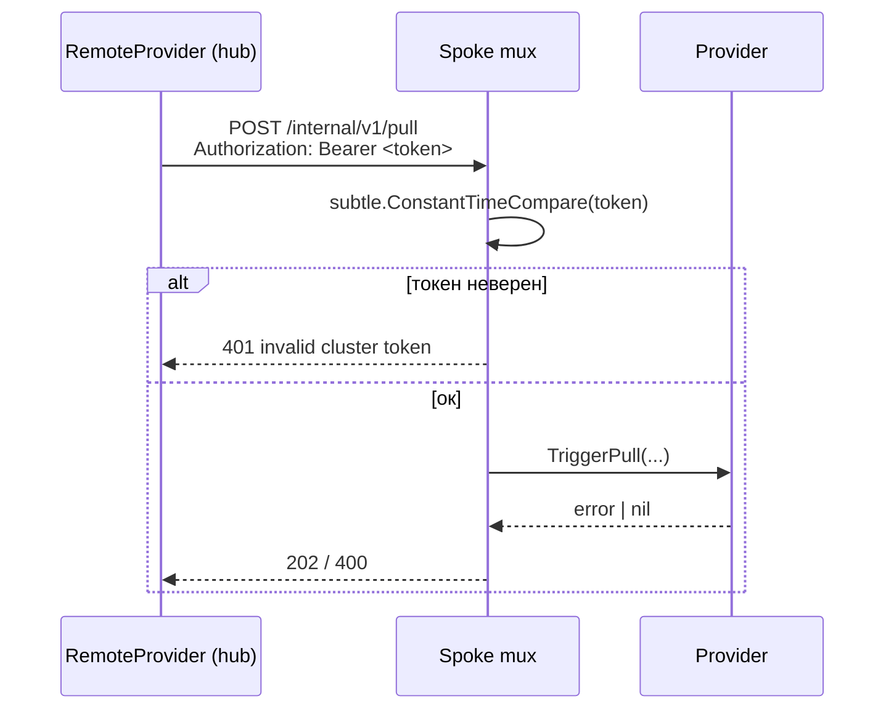

Если `PREPULLER_CLUSTER_TOKEN` пуст, проверка отключается — такой spoke нельзя
публиковать вне доверенной сети.

## 5. Поток данных снапшота

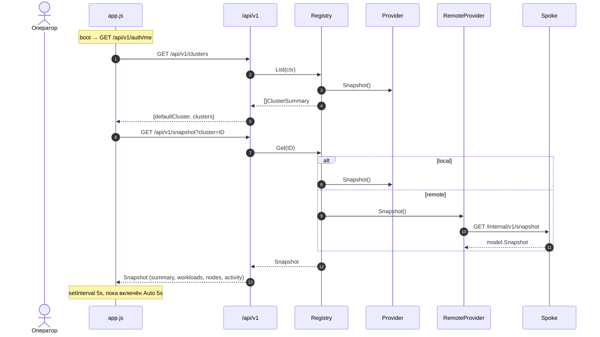

UI не кэширует ничего, кроме последнего снапшота: каждые 5 секунд — `clusters` и
`snapshot` выбранного кластера. Переключение кластера в селекте меняет только
`state.activeCluster` и сразу перезапрашивает снапшот.

## 6. Модель данных

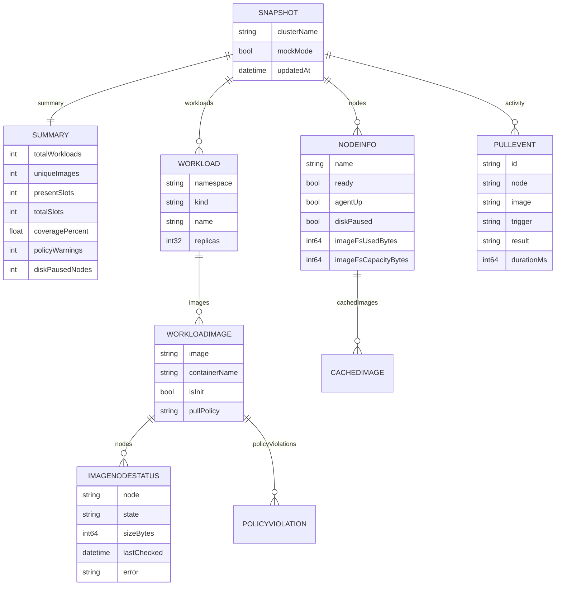

Ключевая метрика — **coverage**: `presentSlots / totalSlots × 100`, где слот — пара
«образ workload'а × worker-нода». Она же уезжает в `prepuller_image_present`.

## 7. Состояния слота и политика диска

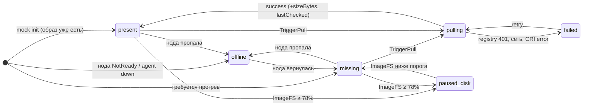

Порядок вычисления состояния в `MockProvider` (и будущем `K8sProvider`):
`offline` (нет ноды) → `paused_disk` (ImageFS ≥ `diskPauseRatio`) → `failed` (ошибка pull)
→ `present`/`missing`. Порог паузы 78% ниже порога kubelet GC 85% намеренно: прогрев
должен остановиться до того, как kubelet начнёт вычищать образы.

Policy-проверки (не блокируют pull, только предупреждают):

- `pull_policy_always` — `imagePullPolicy: Always` ломает offline failover;
- `latest_tag` — нет иммутабельного тега/digest (`:latest`, пустой тег; `@sha256:` — ок).

## 8. Pull-операции

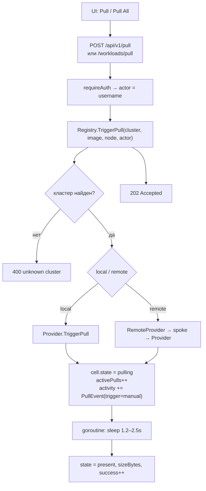

В Stage 1 «pull» — симуляция задержки; реального CRI-вызова нет. Важные свойства,
которые нужно сохранить в живой реализации:

1. Ответ всегда `202` — операция асинхронная, клиент узнаёт результат из следующего снапшота.
2. Повторный `TriggerPull` по слоту в состоянии `pulling` — no-op, а не ошибка (идемпотентность).
3. Офлайн-нода — ошибка `node ... is offline / agent unreachable`, в UI кнопка disabled.
4. `Pull All` не атомарен: возвращает счётчик успешно запущенных слотов, ошибки отдельных
   слотов проглатываются.

## 9. Метрики

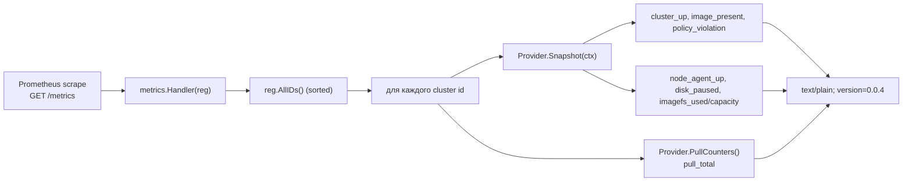

Экспозиция собирается руками (`strings.Builder`), без `prometheus/client_golang` —
зависимостей у модуля нет вообще. Учтите: `Handler` вызывает `Snapshot()` отдельно на
каждое семейство метрик (6 раз на кластер за скрейп). Для mock это дёшево, для live
провайдера нужно кэширование внутри провайдера или один снапшот на запрос.

## 10. Расширение до живого кластера (Stage 2–3)

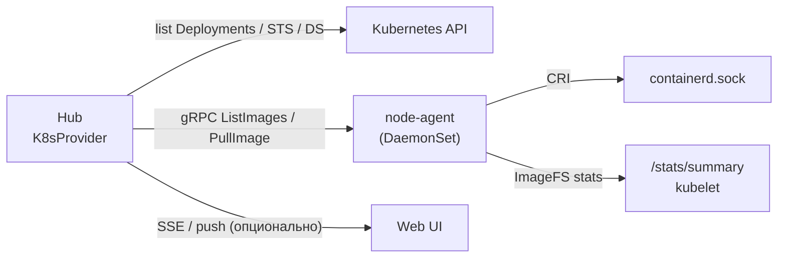

План:

1. **node-agent** (`prepuller agent`) — DaemonSet на каждой ноде: gRPC-сервер, список
   локальных образов и размеров, `PullImage` через CRI, чтение заполнения ImageFS;
   agent сам ставит авто-прогрев на паузу при превышении порога.
2. **K8sProvider** — реализует те же 5 методов: список workload'ов через client-go,
   состояния слотов через аггрегированные ответы агентов, `SyncNow` — внеплановая сверка.
3. **Reconciler** — периодическая сверка «что требует кластер / что уже есть», постановка
   задач прогрева с ограничением параллелизма и приоритетами, backoff на ошибки registry.
4. Hub остаётся без изменений: его контракт — `Provider` + `Registry`, а не детали CRI.

## 11. Эксплуатационные заметки

- Graceful shutdown: 5 секунд на оба сервера; pull-горутины mock при этом завершаются вместе
  с процессом (в живой версии задачи должны переживать рестарт или пересоздаваться reconciler'ом).
- `/healthz` и `/readyz` не проверяют провайдера — readiness говорит лишь о том, что процесс
  поднял HTTP. Для честной проверки нужен отдельный флаг «последний успешный синк».
- Порт метрик слушается отдельным `http.Server` без auth: открывайте его только для Prometheus.
- Один статический пользователь; все действия в activity подписаны его логином (`manual (admin)`).
