# Архитектура Image Prepuller

Документ описывает текущую (Stage 1, mock) архитектуру и заложенные точки расширения.
Все схемы — Mermaid, рендерятся в GitHub/Gitea/GitLab и Obsidian.

## 1. Роли и топология

Один бинарь `prepuller` с двумя ролями:

| | hub | spoke |
| --- | --- | --- |
| Флаг | `-role=hub` (по умолчанию) | `-role=spoke` |
| Web UI | да (embed static) | нет |
| Авторизация | cookie-сессия оператора | Bearer-токен кластера |
| Публичный API | `/api/v1/*` | — |
| Внутренний API | `/internal/v1/spokes/*` для outbound-spoke | `/internal/v1/*` |
| Кластеры | локальный + управляемые (`RemoteProvider` в direct, `PushProvider` в outbound) | ровно один локальный |
| Метрики | `:9090/metrics` по всем кластерам | `:9090/metrics` по своему |
| Требует K8s в Stage 1 | нет (`-mock`) | нет (`-mock`) |

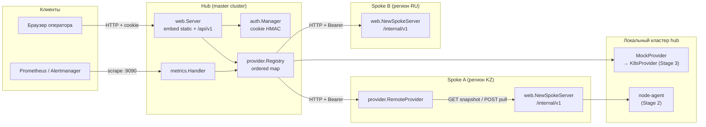

Интерактивная схема продукта — два кластера (`talos-prod-kz`, `talos-stage-ru`), наш
софт в каждом, тестовый Deployment, матрица `image × node` с прогретым на всех воркерах
образом и пример отказа ноды:
[docs/diagrams/image-prepuller-overview.html](diagrams/image-prepuller-overview.html)
(исходник — `docs/diagrams/image-prepuller-overview.json`, PNG для README —
`docs/diagrams/image-prepuller-overview.png`). Mermaid-схемы ниже остаются
каноническими для markdown-рендера; HTML-артефакт нужен для чтения схемы с зумом
и подсветкой связей.

### 1.1 Outbound-канал: spoke → hub

Прямая схема выше требует, чтобы hub мог достучаться до spoke по HTTP. Если
управляемый кластер за NAT или в нём нет ingress, направление обратное: spoke
запускается с `-hub-url`, сам подключается к ingress'у hub'а и держит канал —
пушит состояние кластера и long-poll'ит команды.

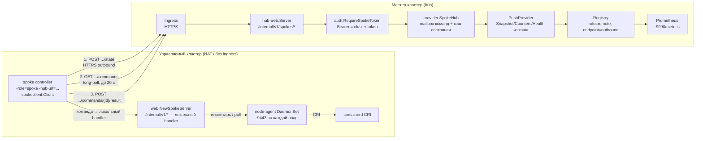

Входящих стрелок в управляемый кластер на схеме нет: hub никогда не инициирует
соединение к нему, весь трафик идёт из управляемого кластера наружу на 443 (или по
HTTP внутри доверенной сети). Hub → node-agent остаётся внутри управляемого кластера:
команду исполняет локальный handler spoke'а, который и ходит к агентам.

**State cache.** Spoke раз в `-hub-sync-interval` (по умолчанию 3 s) отправляет
`SpokeState`: тот же snapshot и counters, что отдают `GET /internal/v1/snapshot` и
`GET /internal/v1/counters` в direct-режиме. Hub складывает их в `SpokeHub` и
обслуживает чтения (snapshot для UI/API, counters для метрик, health) из кэша, не делая
запрос на каждый вызов. Молчащий дольше `max(3 × syncInterval, 10 s)` spoke считается
offline: snapshot `syncStatus=offline` + `partial=true`, health `online=false` с
возрастом последнего push, `prepuller_cluster_up=0`, `prepuller_cluster_sync_partial=1`.
Пока hub отдаёт последний успешный снапшот (например, при таймауте скрейпа),
`prepuller_snapshot_age_seconds` растёт; после подмены на offline-заглушку с нулевым
`LastSyncAt` серия пропадает — основным сигналом остаётся `prepuller_cluster_up`.

**Mailbox команд.** State-changing вызовы (pull, workload-pull, cancel, reconcile)
превращаются в `SpokeCommand{id, method, path, query, body}` и ждут в очереди
кластера; spoke забирает их long-poll'ом (`GET /internal/v1/spokes/{cluster}/commands`,
ответ 204, если за 20 s ничего не появилось) и исполняет через собственный handler,
после чего отправляет `SpokeCommandResult` (исходный HTTP-статус и тело). Hub
по-прежнему использует `RemoteProvider` поверх mailbox-транспорта, поэтому маппинг
статусов прежний: 409 — задача уже завершена, 404 — неизвестная задача, 5xx/транспорт —
502. Доставка at-least-once: неподтверждённая команда переотправляется через 10 s, spoke
дедуплицирует по id (кэш последних 512 результатов), поэтому повтор не перезапускает
исполненную команду. Один round trip ограничен 5 s (таймаут попытки — тот же, что
у сетевого таймаута direct-режима; retry-политика state-changing вызовов не менялась);
живой pull на spoke запускается асинхронно и в этот бюджет укладывается, поэтому
командный транспорт его больше не ограничивает; а вот
синхронный и дольше, поэтому такой вызов вернёт 502 (как и в direct-режиме), а задача
продолжится на spoke.

**Аутентификация.** Каждый кластер регистрируется на hub'е с собственным токеном
(`PREPULLER_MANAGED_CLUSTERS="name=token"`); все три ручки `/internal/v1/spokes/*`
идут через `auth.RequireSpokeToken` и Bearer-токен кластера, cookie здесь не
принимается. Hub никогда не отключает проверку: неизвестный кластер — 404, несовпавший
токен — 401.

## 2. Компоненты и зависимости пакетов

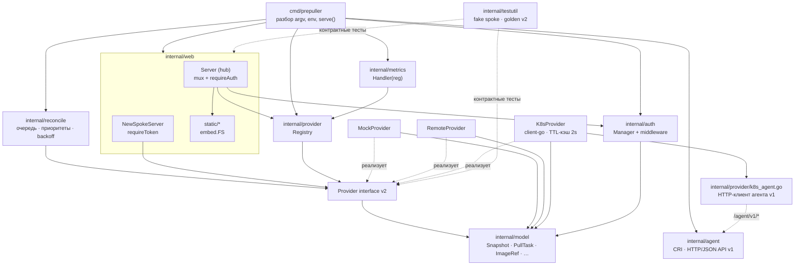

`Provider` v2 — единственная точка расширения под Kubernetes (contract-v2):

```go
type Provider interface {
    Snapshot(ctx) model.Snapshot
    TriggerPull(ctx, model.PullRequest) (model.PullTask, error)
    TriggerWorkloadPull(ctx, model.WorkloadPullRequest) (int, error)
    CancelPull(ctx, taskID string) error
    SyncNow(ctx, actor string) error
    Health(ctx) model.Health
    PullCounters() []model.PullMetricSample
}
```

Hub, spoke, метрики и UI не знают, mock это или живой кластер. Поэтому новый провайдер
не требует правок ни в роутинге, ни в шаблонах метрик. Границы зависимостей
(grpc+cri-api только в агенте, client-go только в `internal/provider/k8s*.go`,
hub-обвязка на stdlib) зафиксированы в [ADR-001](adr/0001-dependencies.md) и проверяются
на ревью; `internal/testutil` даёт фейковый spoke и golden-снапшот для контрактных тестов.

`K8sProvider` берёт инвентарь образов ноды через интерфейс `NodeInventorySource`
(`internal/provider/k8s_inventory.go`); его рабочая реализация — HTTP-клиент к node-agent
(`internal/provider/k8s_agent.go`), который ходит в `/agent/v1/*`. Пока агент недоступен,
включён `UnavailableInventorySource`: слоты получают `offline`, снапшот — `degraded`/`partial`.

## 3. Запуск и регистрация кластеров

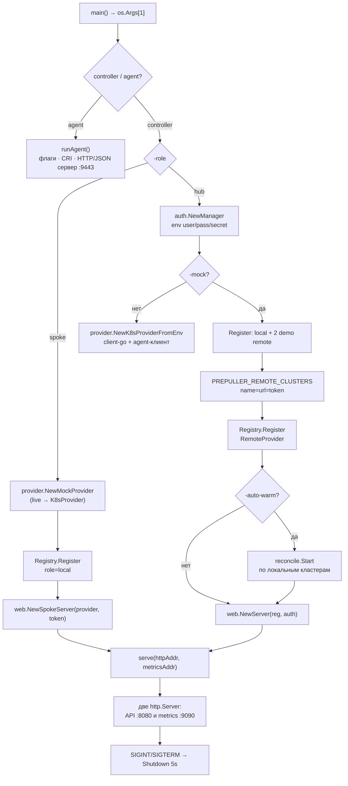

Порядок `Register` важен: `Registry.DefaultID()` — первый зарегистрированный кластер,
именно он открывается в UI по умолчанию. `AllIDs()` сортирует id, поэтому порядок
метрик стабилен и не зависит от порядка регистрации.

В live-режиме (без `-mock`) hub поднимает `K8sProvider`: kube-конфиг берётся из
in-cluster service account, иначе из `$KUBECONFIG`/`~/.kube/config`; токен агента —
`PREPULLER_AGENT_TOKEN`. С флагом `-auto-warm` для каждого локального кластера
запускается свой `reconcile.Reconciler` под тем же signal-контекстом, что и HTTP-серверы;
удалённые кластеры пропускаются — reconciler рядом с ними запускает spoke.

Управляемые кластеры регистрируются двумя путями. `PREPULLER_REMOTE_CLUSTERS`
(`name=url=token`) создаёт `RemoteProvider`: hub сам ходит в spoke по HTTP.
`PREPULLER_MANAGED_CLUSTERS` (`name=token`) создаёт `SpokeHub` + `PushProvider`:
кластер получает в реестре роль `remote`, endpoint `outbound`, а его spoke сам
подключается к hub'у. Оба пути кладут провайдера в один `Registry`, поэтому UI,
метрики и reconciler работают с управляемым кластером одинаково; регистрировать одно
имя дважды нельзя — в реестре останется последняя запись.

## 4. Аутентификация

### Hub — cookie-сессия

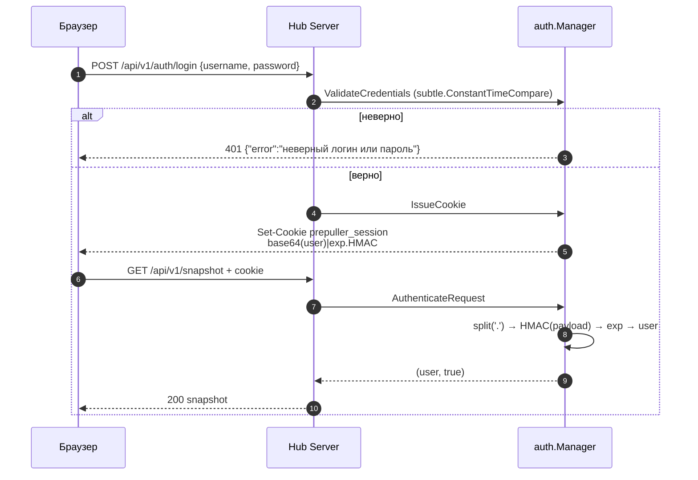

Свойства: HttpOnly, SameSite=Lax, `Secure` при TLS или `X-Forwarded-Proto: https`,
TTL 24 часа, подпись HMAC-SHA256, сравнение подписи и пароля — constant-time.
Секрет берётся из `PREPULLER_SESSION_SECRET`; если пуст — 32 случайных байта на процесс,
то есть после рестарта все сессии инвалидируются.

### Spoke — Bearer-токен

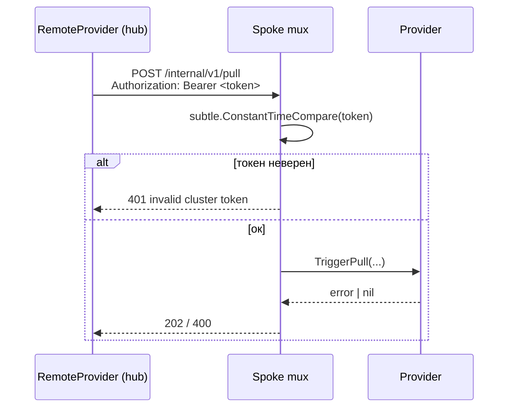

Если `PREPULLER_CLUSTER_TOKEN` пуст, проверка отключается — такой spoke нельзя
публиковать вне доверенной сети.

## 5. Поток данных снапшота

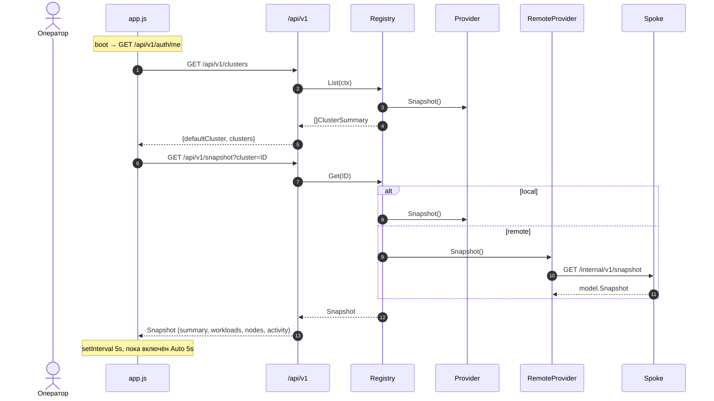

UI не кэширует ничего, кроме последнего снапшота: каждые 5 секунд — `clusters` и
`snapshot` выбранного кластера. Переключение кластера в селекте меняет только
`state.activeCluster` и сразу перезапрашивает снапшот. В outbound-режиме запрос
`GET /internal/v1/snapshot` к spoke не выполняется: `PushProvider.Snapshot` отдаёт
последний pushed-снапшот (и offline-заглушку, если spoke замолчал), поэтому UI
показывает состояние с задержкой порядка sync-интервала.

### Надёжность транспорта hub ↔ spoke

**Direct.** `RemoteProvider` держит один `http.Client` с ограниченным пулом соединений
и таймаутом 5 s на попытку. Идемпотентные state-changing вызовы (`pull`,
`workloads/pull`, `cancel`, `reconcile`) повторяются до 3 раз с экспоненциальным
backoff (150 ms → 2 s); чтения (`snapshot`, `counters`, `health`) — ровно один запрос,
чтобы мёртвый spoke не тормозил страницу и скрейп метрик. Ошибки типизированы:
`ErrSpokeUnavailable`/`ErrSpokeUnauthorized` → `502`, `ErrTaskNotActive` → `409`;
`Snapshot` по-прежнему деградирует в offline-снапшот, а `PullCounters` возвращает `nil`.

**Outbound.** Тот же `RemoteProvider` используется поверх mailbox-транспорта
(`commandTransport`), поэтому правила статусов не меняются, но меняется природа
таймаутов и доставки:

- `SpokeHubConfig.CommandTimeout` = 5 s на один round trip (ожидание в очереди +
  исполнение), то есть на одну попытку — это тот же бюджет, что у 5-секундного сетевого
  таймаута прямого режима; retry-политика state-changing вызовов остаётся
  прежней (до 3 попыток). Живой pull на spoke стартует асинхронно (202 + running-задача)
  и укладывается в бюджет; сама загрузка идёт в фоне, а отмена приезжает следующей командой.
- Доставка команд **at-least-once**: неподтверждённая команда переотправляется через
  10 s; spoke дедуплицирует по id (кэш последних 512 результатов) и на повтор только
  переотправляет сохранённый результат, не исполняя команду заново. Поэтому исполнение
  обязано быть идемпотентным (`TriggerPull` идемпотентен по image+node).
- Чтения не ходят в spoke вовсе: `PushProvider.Snapshot/PullCounters/Health` читают
  кэш последнего pushed-состояния. Нет свежего состояния — offline-снапшот
  (`syncStatus=offline`, `partial=true`), `PullCounters() = nil`, health
  `online=false` с возрастом последнего push. `Health.LatencyMs` на этом канале
  всегда 0: RTT hub не измеряет, сигнал — `PushProvider.SyncAge()`.
- Сбой одного цикла не блокирует другой: push состояния и long-poll команд — независимые
  горутины spoke-клиента; транспортные ошибки логируются не чаще раза в минуту на ключ.

## 6. Модель данных

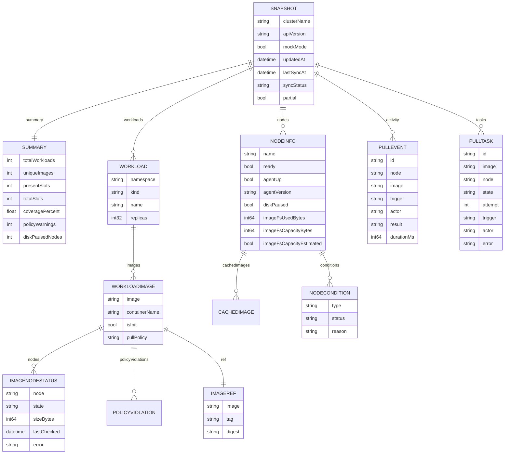

Ключевая метрика — **coverage**: `presentSlots / totalSlots × 100`, где слот — пара
«образ workload'а × worker-нода». Она же уезжает в `prepuller_image_present`.
`imageFsCapacityEstimated` означает, что ёмкость ImageFS пришла не из CRI, а из
`ephemeral-storage` ноды (containerd на Talos отдаёт только `used`), и в UI помечена
как оценка.

История pull-задач живёт **на hub**, а не в провайдере: `internal/tasks.Store`
держит ограниченный список `PullTask` по всем кластерам (опционально JSONL-файл) и
наполняется из каждого снапшота; `GET /api/v1/pull-tasks` отдаёт её страницами
(`limit`/`offset`/`state`). Поэтому история не зависит от того, сколько задач
конкретный провайдер держит в памяти.

## 7. Состояния слота и политика диска

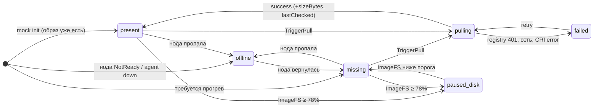

Порядок вычисления состояния в `MockProvider` (и будущем `K8sProvider`):
`offline` (нет ноды) → `paused_disk` (ImageFS ≥ `diskPauseRatio`) → `failed` (ошибка pull)
→ `present`/`missing`. Порог паузы 78% ниже порога kubelet GC 85% намеренно: прогрев
должен остановиться до того, как kubelet начнёт вычищать образы.

Policy-проверки (не блокируют pull, только предупреждают):

- `pull_policy_always` — `imagePullPolicy: Always` ломает offline failover;
- `latest_tag` — нет иммутабельного тега/digest (`:latest`, пустой тег; `@sha256:` — ок).

## 8. Pull-операции

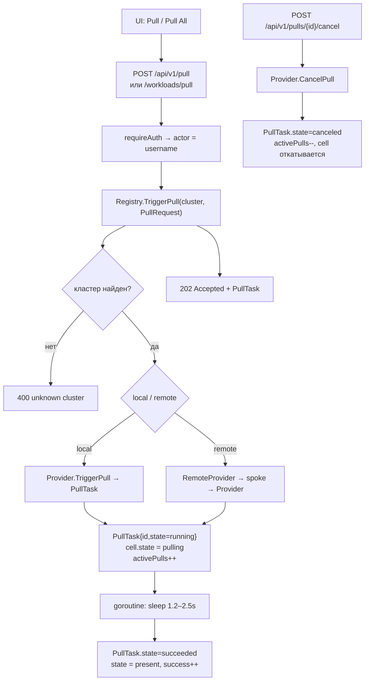

В Stage 1 «pull» — симуляция задержки; реального CRI-вызова нет. Важные свойства,
которые нужно сохранить в живой реализации:

1. Ответ всегда `202` + `PullTask` — операция асинхронная, клиент узнаёт результат из
   следующего снапшота (`Snapshot.Tasks`/`Snapshot.Activity`) или из `/api/v1/pull-tasks`.
2. Повторный `TriggerPull` по активной паре image+node возвращает существующую задачу
   (тот же `id`) — идемпотентность, а не ошибка.
3. Офлайн-нода — ошибка `node ... is offline / agent unreachable`, в UI кнопка disabled.
4. `CancelPull` отменяет только `queued`/`running`; завершённая задача — ошибка,
   неизвестный id — `provider.ErrTaskNotFound` (hub отдаёт 404). В live-пути отмена
   закрывает запрос к агенту: агент отменяет CRI `PullImage` на ноде, задача
   становится `canceled` (не `failed`), счётчик пишется с `result=canceled`.
5. `Pull All` не атомарен: возвращает счётчик созданных задач (образ × нода в области
   действия) и не фильтрует ноды по `Ready`/`AgentUp` — задача на недоступную ноду
   создаётся и завершается `failed` с причиной, чтобы оператор видел, а не гадал.
6. **Зависший реестр не занимает слот.** В live-пути pull выполняется асинхронной
   горутиной hub (hub → агент → CRI `PullImage`), и CRI не даёт прогресса, поэтому
   агент ограничивает его сам:
   preflight TCP-проба реестра (`-registry-probe-timeout`, 5 s) отдаёт
   `502 registry unreachable`, а stall watchdog по отсутствию роста ImageFS
   (`-pull-stall-timeout`, 60 s) — `504 pull stalled`. Hub превращает 504 в
   `provider.ErrAgentPullStalled` (HTTP 504), задача сразу `failed`, слот
   освобождается; `DefaultAgentPullTimeout` (10 min) остаётся страховкой для
   действительно долгих загрузок. Подробности — AGENTS.md §8.
7. **Креды приватного реестра едут в запросе, а не в конфиге ноды.** CRI не
   применяет `imagePullSecrets` пода, поэтому анонимный pull в реестр с логином
   получает `403`. Провайдер — единственная компонента с clientset — строит
   индекс image → `imagePullSecrets` из снапшота, резолвит Secret в namespace
   workload'а (`.dockerconfigjson`/`.dockercfg`, кэш 5 мин) и передаёт
   креды в `POST /agent/v1/pulls`; агент кладёт их в CRI `AuthConfig`. Ответ
   реестра 401/403 агент помечает `reason:"registry_auth"`, хаб превращает его в
   `provider.ErrAgentRegistryAuth` и добавляет подсказку, каких Secret'ов не хватило.
   Агент в apiserver не ходит: право `get` на secrets нужно только hub/spoke
   (`rbac.readSecrets`).

## 9. Метрики

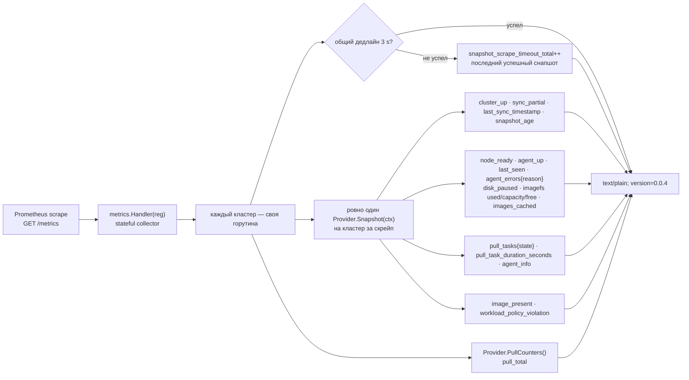

Экспозиция собирается руками (`strings.Builder`), без `prometheus/client_golang` —
эта зависимость запрещена ADR-001, как и любые UI/роутинг-фреймворки. Внешние
зависимости модуля ограничены агентом (grpc+cri-api) и K8s-провайдером (client-go).

**Скрейп не слепнет при аварии.** `Handler` создаёт один stateful-коллектор на всё
время жизни процесса: каждый `Provider.Snapshot` вызывается в своей горутине, все
кластеры параллельно, общий дедлайн `snapshotDeadline = 3 s`
(`internal/metrics/prometheus.go`). Не успевший кластер получает
`prepuller_snapshot_scrape_timeout_total{cluster}` и в вывод идёт его последний
успешный снапшот из коллектора — со своим `LastSyncAt`, поэтому
`prepuller_snapshot_age_seconds` растёт (это и есть сигнал «hub ослеп»). Кластер,
который ни разу не отвечал, не получает ни одной серии, кроме счётчика таймаутов:
нули выглядели бы как здоровый кластер. `PullCounters` качается в той же горутине и
в тот же дедлайн; не успел — берутся прошлые counters. Брошенная горутина пишет в
буферизованный канал, а после возврата хендлера `r.Context()` отменяется, поэтому
снапшот провайдера быстро отпускает мьютекс. Инвариант «ровно один `Snapshot()` на
кластер за скрейп» сохранён (`TestHandlerCallsSnapshotOncePerCluster`). До этого
изменения partition стоил 5 s × число нод и ронял весь скрейп по `scrape_timeout`.

Семантика: `prepuller_cluster_up=0` при `syncStatus=offline` или `partial=true`;
`prepuller_cluster_last_sync_timestamp_seconds` отсутствует, если `LastSyncAt`
неизвестен (нулевое время), и никогда не подменяется текущим временем;
`prepuller_node_last_seen_timestamp_seconds` отсутствует при нулевом `LastSeen`.
`pull_task_duration_seconds` — gauge со средним по терминальным задачам
(гистограмма в text 0.0.4 без client_golang потребовала бы bucket-серий и
нескольких sample с одинаковым label-set, что невалидно).

**Ошибки агента на hub:** `prepuller_node_agent_errors_total{cluster,node,reason}`
заполняет `K8sProvider` — единственный, кто реализует опциональную capability
`provider.AgentErrorCounter` (в замороженный интерфейс `Provider` её сознательно не
добавляли). `provider.ClassifyAgentError` сводит ошибку инвентаря к закрытому набору
`unauthorized|protocol|timeout|unavailable`; эмитятся только реально наблюдавшиеся
reason'ы. У mock и remote кластеров серии нет — это норма.

**Метрики node-agent (отдельный порт).** Агент поднимает второй листенер
(`-metrics-addr`, по умолчанию `:9444`, без авторизации) и отдаёт только
счётчики/gauge'и, которые уже знает: запросы по `endpoint`/`code`, время последнего
контакта по каждому endpoint (инициализируется стартом процесса, поэтому «к агенту
никто не ходил» алертится сразу), статус CRI по последнему снапшоту, pull-счётчики
по результату, ImageFS и число образов из последнего успешного снапшота. На скрейпе
агент не ходит в CRI и в сеть, поэтому скрейп не может заблокироваться. Вместе с
`prepuller_node_agent_up` и `prepuller_node_last_seen_timestamp_seconds` это даёт
триангуляцию «агент умер / токен / связь hub→агент» — таблица в `docs/alerts.md`.

### 9.1 Опциональная статистика в PostgreSQL (ADR-002)

Метрики описывают только «сейчас», поэтому hub умеет писать историю работы с образами
во внешнюю PostgreSQL (`internal/stats`, выключено без `-stats-dsn`). Отдельного
источника данных нет: раз в `-stats-interval` hub берёт обычный `Provider.Snapshot`
каждого кластера и **диффит его с предыдущим срезом**.

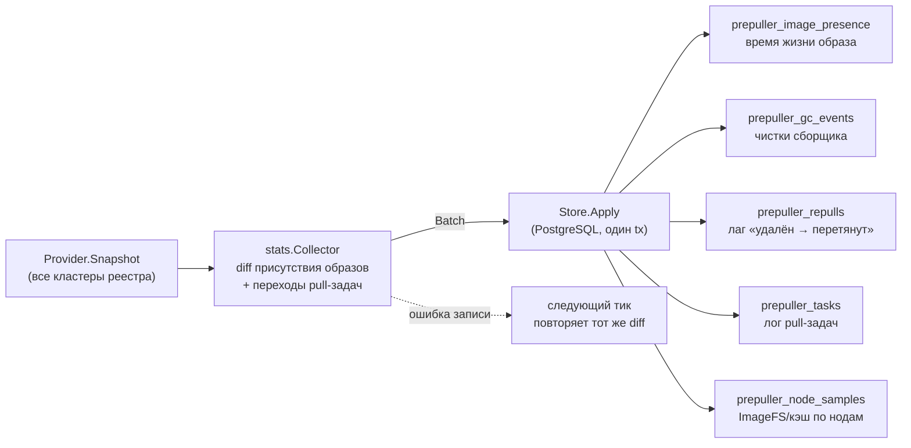

Инварианты: hub **никогда не блокируется** на БД (срез считается в фоне, запись best
effort, при ошибке diff не коммитится и повторяется), DSN не логируется, а тесты не
требуют реальной PostgreSQL (чистый diff + фейковый `database/sql`-драйвер).
`Collector.Commit` вызывается только после успешного `Apply` — иначе пропавшие образы
были бы потеряны. Диаграммы и таблицы — README «Статистика в PostgreSQL», ADR-002.
## 10. Расширение до живого кластера (Stage 2–3)

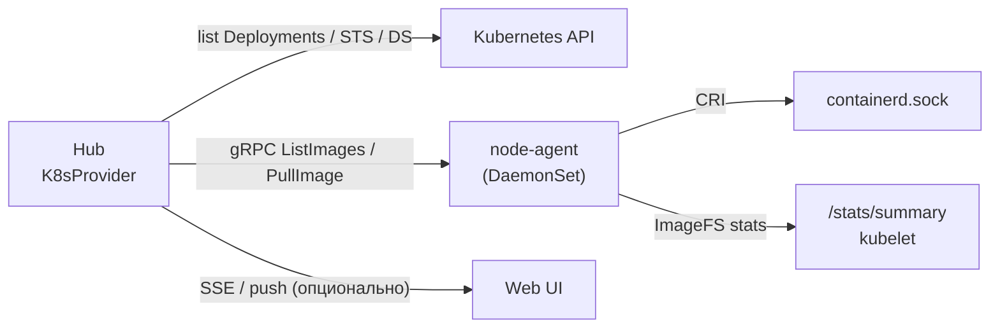

План:

1. **node-agent** (`prepuller agent`) — DaemonSet на каждой ноде: gRPC-сервер, список
   локальных образов и размеров, `PullImage` через CRI, чтение заполнения ImageFS;
   agent сам ставит авто-прогрев на паузу при превышении порога.
2. **K8sProvider** — реализует те же методы Provider v2: список workload'ов через
   client-go (list/watch, кэш), состояния слотов через агрегированные ответы агентов,
   `SyncNow` — внеплановая сверка, `PullCounters`/`Health` — для метрик и UI.
   Скелет с clientset уже в `internal/provider/k8s_stub.go` (WS-B заменяет заглушки).
3. **Reconciler** — периодическая сверка «что требует кластер / что уже есть», постановка
   задач прогрева с ограничением параллелизма и приоритетами, backoff на ошибки registry.
4. Hub остаётся без изменений: его контракт — `Provider` + `Registry`, а не детали CRI.

## 11. Эксплуатационные заметки

- Graceful shutdown: 5 секунд на оба сервера; pull-горутины mock при этом завершаются вместе
  с процессом (в живой версии задачи должны переживать рестарт или пересоздаваться reconciler'ом).
- `/healthz` и `/readyz` не проверяют провайдера — readiness говорит лишь о том, что процесс
  поднял HTTP. Для честной проверки нужен отдельный флаг «последний успешный синк».
- Порт метрик слушается отдельным `http.Server` без auth: открывайте его только для Prometheus.
- Один статический пользователь; в activity действия подписаны парой
  `trigger: manual` + `actor: <логин>` (contract v2 разделил триггер и актора).